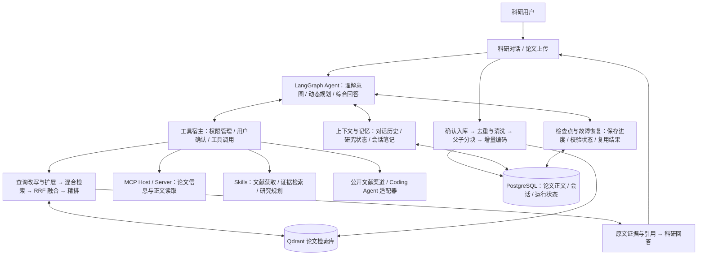
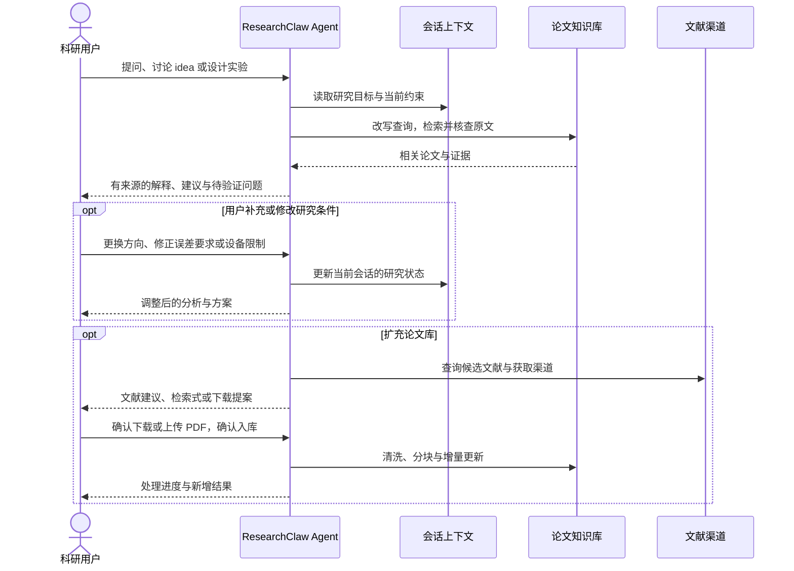

# ResearchClaw：面向个人论文库的科研 Agent

ResearchClaw 是围绕作者日常科研需求开发的论文库 Agent，主要服务于时间序列压缩与误差控制方向。它将论文阅读、知识检索、idea 讨论和实验方案设计放进同一个对话环境，让已经读过的文献成为能够持续积累、检索和核查的研究资料。

科研讨论往往会随着阅读不断变化。用户可以中途换方向、补论文或重新校准约束，ResearchClaw 会结合当前问题、论文证据和本会话中的研究决定继续讨论。对于尚缺资料的方向，它可以给出检索式、查询公开文献渠道，并在用户确认后将新论文补充进知识库。

目前系统基于 **204 份 PDF、约 1.1 万个检索片段**完成验证。200–500 份论文是硕士生日常阅读和课题研究的主要使用范畴，系统围绕这一规模优化增量更新与连续问答，并设置 2000 份论文的容量保护上限。

## 1. 项目概览

对于使用者，ResearchClaw 的核心价值是把“找过哪些论文、证据在哪里、研究条件改过什么”连接起来。例如，讨论一种压缩方法时，可以追问它的误差保证；提出一个改进想法时，可以查找相近工作；改成普通笔记本可运行的方案后，也可以继续调整基线和实验指标。

主要功能包括：

- **论文问答与来源定位**：根据自然语言查询相关文献，解释方法、假设与适用条件，并提供论文、页码和原文片段。
- **Idea 分析与研究建议**：结合库内工作判断重合点，提出有证据支持的改进方向和需要实验验证的假设。
- **文献发现与增量入库**：生成学术检索式、查询公开渠道、提出下载建议，接收用户上传的论文并按需更新知识库。
- **实验方案与基线设计**：围绕研究目标、设备条件和时间预算，讨论基线、数据划分、评价指标及消融方案。
- **连续对话与研究状态管理**：保留同一会话中的上下文、研究约束和确认笔记，支持会话创建、命名、继续与删除。
- **工具协作与安全执行**：按需调用检索工具、MCP 和 Skills，通过用户确认控制下载、入库及编码任务交接。

从开发者视角看，系统采用 **LangGraph 单 Agent + 动态任务 DAG**：模型负责理解问题、选择工具和组织回答，运行宿主负责状态管理、权限校验、执行预算与检查点。简单问题直接回答，存在依赖的任务可以按需拆分，并根据后续反馈调整计划。

数据层采用明确的职责划分：**PostgreSQL** 保存消息、会话状态、论文正文、元数据和运行检查点；**Qdrant** 承担论文的向量与关键词候选召回；原始 PDF 保存在文件系统。后端使用 FastAPI 提供统一服务。

## 2. 系统架构与使用流程

### 系统架构



### 用户使用流程



## 3. 从科研问题到可核查的回答

### 理解问题，找到合适的检索方向

用户可以直接用自己的表述提问。系统结合研究语境澄清概念，将中文问题转化为适合英文论文的查询，并在需要时补充相关术语或拆解子问题。例如，“压缩后误差能不能保证”可能涉及最大绝对误差、相对误差或平均误差，明确度量后才能找到真正适用的论文。

> “我关心的是每个采样点的最大偏差，论文里一般用什么术语描述这种保证？”

对于还在收敛的选题，Agent 可以从已有知识出发列出可研究的方向，也可以提供 Google Scholar、arXiv 等渠道的检索式，帮助用户继续补充资料。

### 把论文变成有来源的知识

论文入库时先进行内容去重、文本清洗和解析质量分级，再建立用于检索的片段。系统保留论文页码与片段之间的父子关系：较小片段负责准确匹配问题，较大的上下文帮助理解方法和前提；识别到的章节信息用于辅助定位。这样既便于检索一句关键条件，也能回到所在页面继续阅读。

> “这篇 PLA 论文的误差约束是针对原始采样点，还是针对重建后的整条曲线？请给出原文位置。”

新增论文按内容变化处理，已有论文的解析和向量结果可以复用。用户补入几篇新文献时，知识库会围绕新增内容更新，并同步关键词检索所需的统计信息。处理过程提供解析与构建进度，便于了解本次实际新增的内容。

### 兼顾语义与关键词，优先呈现有效证据

科研查询既有语义表达，也有精确术语。向量检索用于发现意思相近的内容，BM25 关键词检索用于匹配算法名、专业词和特定条件。系统通过 RRF 融合两类候选，再用精排判断哪些片段更适合回答当前问题。

> “Gorilla 和 Chimp 分别利用了浮点数据的什么特征？我应该先读哪篇来理解它们的区别？”

对于指定论文的问题，检索会优先围绕目标文献取证，并保留相关背景作为补充。生成回答时关联论文与原文位置，让用户可以继续追问或打开来源核查。

### 从文献证据延伸到 idea 与实验草案

讨论 idea 时，Agent 先查找已有工作中的相似设计，再区分论文已经支持的结论、基于证据的推理和待实验验证的假设。随后可以围绕研究目标提出基线、数据集、指标和消融建议，帮助用户将一个宽泛想法收敛为可执行的研究问题。

> “用局部波动决定分段位置，再统一保证最大绝对误差，这个想法与已有自适应 PLA 方法有哪些重合？”

> “如果只做一个两周内能完成的实验，应该选哪些基线？压缩率之外还需要记录什么？”

文献扩展也可以来自已经读到的参考文献。系统可读取本地论文的参考文献，推荐值得进一步获取的候选工作；获取新论文后，再将它们纳入后续讨论。实验执行通过明确的任务准备和用户确认衔接 Coding Agent。

### 在连续讨论中保留研究约束

系统同时维护最近对话、与当前问题相关的历史片段、显式研究状态和用户确认的笔记。设备、误差指标、基线选择等关键约束可以持续保留；用户更正条件后，后续建议以新的决定为依据。

> “把误差上限改为 0.004，设备条件沿用本会话之前确认的配置。请重新检查实验指标。”

每个会话拥有独立的研究上下文，同项目的论文知识库则持续共享。重新打开原会话可以继续课题讨论，新会话适合开启另一条研究思路。删除会话时同步清理其对应记忆与检查点。

### 按需使用工具，保留可恢复的研究进度

Agent 可以根据问题选择论文检索、原文读取、文献渠道查询或研究规划等能力。MCP 为论文信息与正文读取提供标准工具接口，Skills 封装可复用的研究能力，运行宿主统一校验权限和用户确认。

涉及多个依赖步骤时，Agent 可以建立任务 DAG，并在过程中保存检查点。发生中断后，系统校验当前状态，复用已完成的结果；对于执行效果需要核对的操作，交由用户确认后继续。这让较长的研究任务能够保留进度，也让用户掌握知识库和实验动作的控制权。

## 4. 启动方式

本项目使用 Python 3.12 与本机 `.venv`，Docker 运行 PostgreSQL 和 Qdrant。模型服务及数据库连接通过本地配置提供，配置字段见 [.env.example](.env.example) 和 [.env.web.example](.env.web.example)。首次部署时根据模板准备 `.env`、`.env.web` 与 `infra/.env`；已有安装沿用现有配置。

在项目根目录启动基础设施：

```cmd
docker compose --env-file infra\.env -f infra\compose.yaml up -d
```

在独立终端启动后端：

```cmd
.venv\Scripts\activate
python scripts\serve_backend.py
```

在另一个终端启动对话入口：

```cmd
npm.cmd --prefix frontend ci
npm.cmd --prefix frontend run dev
```

访问 `http://127.0.0.1:5173`，API 文档位于 `http://127.0.0.1:8011/docs`。首次创建账号时使用本地配置的注册邀请码，并单独设置个人密码。

## 5. 评估与架构取舍

评估围绕三个问题展开：论文证据是否容易找到，长对话中的研究信息能否被正确使用，以及 Agent 是否能以合理成本选择工具并完成科研任务。内容评分使用 LLM 银标；下列结果分别对应各自的数据集与评估条件。

### 论文检索与回答质量

在 204 份 PDF 上构建英文文献问题集，检索侧 60 题、生成侧 46 题，分别保留 12 题用于选型后的验证。问题覆盖方法定位、跨篇比较、条件与适用范围、版本区分、结构定位和证据不足场景。

检索消融使用相同问题，比较单独向量检索、单独 BM25、两者的 RRF 融合，以及融合后精排：

| 检索方案：12 题验证集 | Recall@5 | MRR@5 | nDCG@5 | 证据页面命中率@10 |
|---|---:|---:|---:|---:|
| 仅向量检索 | 0.8333 | 0.6944 | 0.7132 | 0.5833 |
| 仅 BM25 关键词检索 | 0.9167 | 0.8472 | 0.8376 | 0.6667 |
| 向量与 BM25 的 RRF 融合 | 0.9167 | 0.8750 | 0.8552 | 0.5833 |
| RRF 融合后精排 | 0.9167 | 0.9583 | 0.9167 | 0.8750 |

融合利用了语义与术语的互补性，精排进一步提高了相关证据的排序与页面定位能力。这一设计服务于“先找到论文，再核查具体条件”的阅读方式。检索选型同时观察论文覆盖与证据定位：开发集上，融合后精排的 Recall@5 为 0.8542，单独融合为 0.8750，体现了精确取证与候选覆盖之间的取舍。

生成侧使用 **RAGAS 0.4.3** 评价 12 题验证集。基线直接使用原始问题做向量检索，选取 5 条结果构建页面上下文；当前方案加入查询改写与扩展、向量和关键词融合、精排，以及目标论文约束和命中片段保留。两组使用相同生成模型。

| RAGAS 指标 | 原始问题 + 仅向量检索 | 当前证据检索方案 |
|---|---:|---:|
| Faithfulness：回答对证据的忠实度 | 0.9085 | 0.9156 |
| Answer relevancy：回答相关性 | 0.5724 | 0.7358 |
| Context precision：上下文精确率 | 0.5889 | 0.6625 |
| Context recall：上下文召回率 | 0.5417 | 0.7083 |

结果体现为回答更贴近问题、上下文包含更多有效证据。上述变化来自整套证据组织方案；检索表中的单模块消融用于进一步观察融合与精排的作用。验证集采用按问题划分，评分口径为本地文献任务上的银标评估。

### 增量构建效率

以 194 份论文库为基础补入 12 份 PDF，系统识别 2 份内容重复文件，实际新增 10 份，最终扩展至 204 份。

| 项目 | 实测结果 |
|---|---|
| 新增 10 份论文的构建耗时 | 约 101.16 秒 |
| 新增检索片段 | 618 个 |
| 复用既有向量 | 10,337 条，数值保持一致 |
| BM25 统计与索引刷新 | 约 4.04 秒 |
| 无内容变化的构建检查 | 约 0.49 秒，解析、编码与向量写入均为 0 |

增量设计将主要计算集中在新增资料上，适合阅读过程中每次补充几篇论文的使用节奏；无变更检查则便于重复提交时快速确认知识库状态。

### 单会话上下文与记忆

采用公开 **LongMemEval 的全部 156 道单会话 oracle 问题**，覆盖用户事实、助手历史与偏好。oracle 表示已给定目标会话，评估重点是如何从该会话组织上下文并回答问题。

对照方案保留最近完整对话轮次，并从较早的用户消息中，按“记住、约束、预算、目标”等关键词摘取最多 24 条历史信息。当前方案在保留最近轮次的基础上，使用 BM25 按本轮问题召回历史用户消息和助手回答，为助手回答附带前置用户问题，并补充重要约束片段。

| 评估范围 | 最近轮次 + 关键词触发摘录 | 当前问题驱动召回 + 对话锚点 |
|---|---:|---:|
| 单会话 oracle，156 题 | 48.1% | 86.5% |
| 其中此前未参与评估的 132 题 | 49.2% | 87.9% |
| 20 / 50 / 100 轮派生压力案例，36 个 | 16.7% | 83.3% |

两组使用相同模型、提示和 4096 token 窗口预算。当前方案平均实际输入约 2428 tokens，对照约 1136 tokens，改善包含更充分利用窗口、装入相关历史信息的收益。36 个压力案例由 12 道公开题派生，用于观察长背景对话中的信息保留能力。对于误差阈值、设备条件等科研硬约束，系统进一步通过显式研究状态和确认笔记保存。

### Agent 架构对照

使用 24 个本地科研任务，覆盖论文事实问答、idea 分析、基线设计和文献扩展，在相同配置模型、论文库与领域工具上比较三种实现：基础单 Agent 的 ReAct 工具循环，Planner / Worker / Reviewer 三角色协作，以及当前具备状态校验、动态 DAG 和检查点的 LangGraph 单 Agent。

| 架构 | 银标任务成功率 | 平均耗时 | 平均实际 tokens |
|---|---:|---:|---:|
| 基础单 Agent：ReAct 工具循环 | 91.7% | 51.94 秒 | 19,905 |
| Planner / Worker / Reviewer 三角色 | 79.2% | 103.70 秒 | 43,130 |
| LangGraph 单 Agent + 动态任务 DAG | 95.8% | 50.45 秒 | 21,133 |

这组课题任务以文献阅读、取证和研究草案为主，单 Agent 可以集中维护问题语境；三角色方案增加了证据转述和审查开销。因此，项目选择单 Agent 作为默认实现，将权限、安全确认和执行校验交给运行宿主。三组按同一任务协议分批运行，结果用于本项目的工程选型。

另以 16 类工具意图、每类 2 种表述评估工具选择，路由正确率为 100%。该指标衡量工具选择能力，科研回答质量由上述独立任务评估衡量。

## 6. 代码组织

```text
src/researchclaw/             核心实现
├── harness/                 Agent 运行、上下文、状态与执行治理
├── knowledge/               论文入库、混合检索与证据问答
├── papers/                  文献渠道、下载与解析
├── integrations/            MCP 等工具集成
└── coding/                  Coding Agent 适配与实验交接

backend/src/researchclaw_api/ API、鉴权、会话与后台任务
frontend/                    对话入口
scripts/                     启动、检索与运行维护
config/                      项目配置
infra/                       PostgreSQL 与 Qdrant 基础设施
skills/                      可复用的科研技能
```

## 7. 设计定位与后续方向

作为作者的论文库 Agent，ResearchClaw 将持续积累的论文、带来源的问答、研究状态和工具执行连接起来，支持从理解方法、讨论 idea 到准备实验草案的日常科研活动。开发重点是让新资料容易补入、研究决定能够延续、关键结论能够回到原文核查。

项目围绕个人硕士课题的需求确定实现范围：高并发公开服务、跨会话用户画像、覆盖文献全集的自动综述不属于当前需求，也无须为这些场景增加系统复杂度。跨篇比较围绕用户明确提出的问题展开；创新判断以库内证据为起点，研究假设交由后续实验验证。后续优先改进实际阅读中的证据定位、交互效率与研究工具衔接，使系统持续服务于作者的课题推进。
