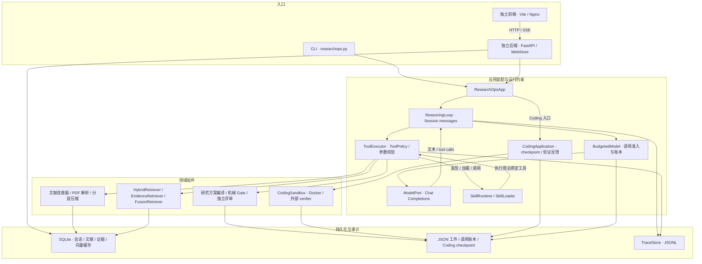
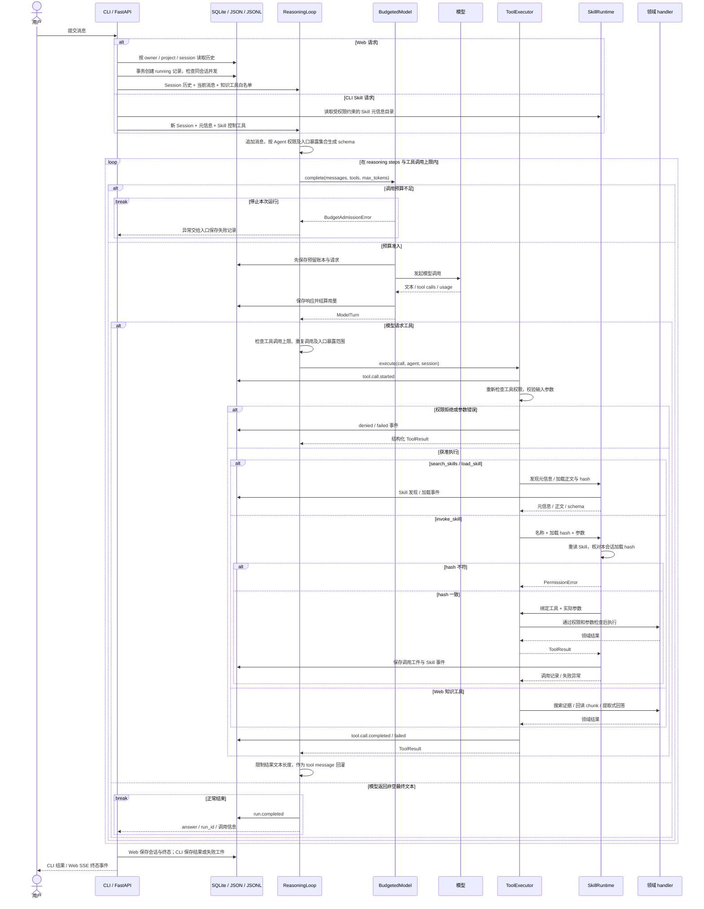

# 简介

ResearchOps 是一个 Python Agent runtime：由模型自主选择工具，通过按需发现、加载和执行 Skill 调用领域能力，由宿主控制工具权限、调用预算、失败处理与执行记录。科研是它的验证场景，覆盖文献获取、证据检索、研究方案编译和代码沙箱验证；CLI 与独立 Web 服务复用核心工具循环。

核心实现位于 [harness/runtime.py](src/researchops/harness/runtime.py)、[Skill runtime](src/researchops/harness/skills/runtime.py) 与 [应用装配](src/researchops/application/workflow.py)。Coding 使用独立的应用循环，复用工具执行、权限、预算准入和 trace 组件。

# 流程图

## 架构分层图



## 一次请求时序图

CLI 的 `agent`、默认 `research` 命令采用 Skill 入口；Web 采用项目知识问答入口。二者共享 `ReasoningLoop`，由各自的 adapter 指定可见工具和会话来源。



# 工作流讲解

1. 用户提交消息后，入口确定本次请求的会话范围。Web 从登录身份定位项目与会话，CLI 按工作区接收任务。
2. 入口准备本次会话的上下文：Web 读取历史消息、创建运行记录并检查同会话并发，CLI 创建新 Session 并读取受权限约束的 Skill 元信息。
3. ReasoningLoop 将当前消息追加到会话，再按 Agent 权限、入口允许集合和工具自身约束生成工具 schema，确定模型本轮可选的能力。
4. 宿主在预算准入后，将会话消息与工具 schema 交给模型。模型根据任务和已有观察决定下一步，返回文本或发起一个或多个工具调用。
5. 模型请求工具时，ReasoningLoop 先检查调用次数、重复调用和入口暴露范围，ToolExecutor 再检查权限与参数。调用 invoke_skill 时，SkillRuntime 还会核对本次提交、会话加载记录与当前文件的 hash。
6. ToolExecutor 将通过校验的调用交给对应 handler 执行，Web 知识工具负责检索、原文回读与证据回答。Skill 入口中，模型按需用 search_skills 查找元信息、用 load_skill 读取正文，再通过 invoke_skill 执行宿主绑定工具。
7. ReasoningLoop 将工具结果转为 tool message，限制长度后追加到会话。权限拒绝、参数错误与 handler 异常同样作为结构化观察返回，模型可据此修正后续调用。
8. 模型带着新观察进入下一轮决策，可以继续调用工具、选择其他 Skill、修正参数，或形成最终回答。
9. 模型返回非空文本且没有工具调用时，ReasoningLoop 正常结束。步数上限、工具调用上限、重复调用、空响应、预算失败或模型异常会终止运行。
10. 入口保存终态并返回结果：Web 持久化会话与运行状态，通过 SSE 返回终态事件；CLI 保存结果或失败工件后交给用户。

# 说明

## 入口先确定会话和能力范围

Web 从 JWT 中取得 `owner`，按 `owner + project + session` 查询历史，再通过 SQLite 事务创建 run。同一会话存在活动 run 时返回冲突，避免两条生成链同时改写历史。CLI Skill 入口创建新的 `Session`，把可用 Skill 的名称和描述放入初始上下文。

工具可见性由宿主确定。`ToolRegistry.visible()` 先应用 Agent 的允许列表、拒绝列表和工具自身的 `allowed_agents`；Skill 入口进一步只暴露 `search_skills`、`load_skill`、`invoke_skill`。Web 则只暴露 `search_knowledge`、`get_chunk`、`answer_with_evidence`。模型因此只在当前入口允许的能力范围内决策。

## 模型决定下一步，宿主保留执行权

`ReasoningLoop` 保存消息、发送工具 schema，并处理模型返回的文本或 tool calls。模型可以选择先发现 Skill、读取操作说明，再执行实际任务；宿主负责调用 handler 和回传观察。Skill 正文只能提供操作说明，实际执行目标来自代码中的固定绑定。

`ToolExecutor` 在进入 handler 前再次调用 `ToolPolicy.authorize()`，随后检查必填字段、额外参数和声明的基础类型。Skill 调用还要通过加载 hash 校验；文件入口检查解析后的实际路径；研究规划 handler 再检查语料、数据和科学任务参数。

这些检查作用不同：可见性减少无效选择，执行授权防止越权调用，hash 校验约束 Skill 版本，handler 检查保护具体资源。工具参数来自模型输出，必须经过执行边界重新验证。

## 工具观察回灌，运行状态如实记录

权限拒绝返回 `denied`；参数或 handler 异常转换为带错误类型和消息的 `ToolResult`。结果写回 `Session.messages`，模型可以据此修正输入或解释阻塞原因。Skill 的真实调用结果同时写入独立 JSON 工件，失败记录保留实际参数、状态和错误。

工具返回给模型的文本受 `max_output_chars` 限制，超长内容转换为截断预览。trace 记录调用开始、完成、拒绝或失败；完整领域结果由相应领域工件承载，模型请求与响应由调用账本目录保存。

## 结束条件由运行代码决定

没有 tool calls 且返回非空文本时，通用 loop 结束。达到 reasoning steps 上限、超过工具调用上限、出现相同工具和参数的重复调用、模型返回的文本与 tool calls 同时为空，都会终止运行。模型调用异常向入口传播，预算准入失败则阻止下一次付费请求。

研究方案在编译、机械检查与独立评审满足交付条件后标记为 `ready_for_coding`；其余结果保留 `blocked_before_coding` 及修订记录。Coding 的完成状态由外部 verifier 和源码指纹共同约束。

# 关键设计决策

## 1. Skill 分成发现、加载和执行

[SkillLoader](src/researchops/harness/skills/loader.py) 发现阶段只读 YAML frontmatter 和绑定清单；`load_skill` 返回选定 Skill 的正文、版本、输入 schema 和 SHA-256；`invoke_skill` 要求提交名称、加载 hash 和参数。四个宿主绑定分别对应文献获取、文档入库、证据检索和研究规划。

这样把“知道有哪些能力”和“掌握如何执行”拆开。模型先按任务选择，再支付正文的上下文成本。宿主还保留了 `eager` 全量加载模式，可在相同任务上比较加载策略的代价。

取舍是多出发现、加载的交互步骤，短任务不一定获得延迟收益。它换来更小的初始提示，以及可核对的执行版本：Skill 文件发生变化后，旧 hash 无法直接调用，必须重新加载。论文和下载内容不进入 Skill 目录扫描，避免把外部资料当作可执行扩展。

## 2. 按信息类型减少上下文，保留原始审计记录

通用 loop 将会话消息和工具观察追加到 `Session.messages`，工具输出通过长度限制控制单次回灌规模；知识工具提供稳定 `chunk_id`，需要原文时用 `get_chunk` 回读。

更强的上下文裁剪位于 [CodingApplication._model_messages()](src/researchops/coding/agent.py)：每次模型调用从完整消息复制发送视图，省略较早 `write_file` 调用中的源码正文，并替换较长的历史工具输出。文件仍在项目目录，可以通过 `read_file` 获取当前内容；完整消息继续保存在 checkpoint 中。

文献信息则由 [PaperCompressor](src/researchops/knowledge/compression.py) 分为 L0 身份卡、L1 筛选卡、L2 全文复现档案和 L3 问题相关综合。L3 先检索有限证据节点，再生成带节点引用的综合；缓存同时关联内容、prompt 和实现版本。

结构化省略和按需回读减少旧源码与长材料反复占用输入，原始记录保留生成依据。代价是模型可能需要额外读取文件或证据；摘要用于筛选与综合，引用保留节点身份和原文定位。

## 3. 工具可见性和执行权限分别检查

[ToolPolicy 与 ToolExecutor](src/researchops/harness/runtime.py) 共同形成执行边界：允许列表决定模型可以选择什么，执行时的授权决定 handler 能否进入。即使模型构造了隐藏工具名，Skill 入口也会返回拒绝；`invoke_skill` 内部调用目标工具时，仍然重新经过 executor。

Skill 的授权还包含版本约束：`load_skill` 将 hash 写入当前会话的 `loaded_skills`，`invoke_skill` 重新读取文件，要求调用 hash、会话加载 hash 和当前文件 hash 一致。声明 `requires_confirmation` 的工具在缺少显式确认时被拒绝。

资源边界由具体 handler 落实。CLI 文件路径先 `resolve()`，再校验是否位于工作区或显式 `--allow-root` 内；Skill 目录只接受宿主绑定名称，并检查目录、文件和链接边界。Web 查询会话、run 和知识库均使用认证身份对应的项目范围。

每个新增 handler 都要明确资源权限。schema 检查负责调用形状，业务范围和取值约束由 handler 校验，两层职责需要同时维护。

## 4. 预算先预留再调用，失败请求保留未知成本

[BudgetedModel](src/researchops/harness/budget.py) 在发起请求前调用 [reserve_call](src/researchops/coding/budget.py)，用序列化输入的 UTF-8 字节数、消息 framing、输出上限和 provider 余量估算预留。准入成功后先落盘账本和请求，再向模型服务发送调用。

服务端返回有效 usage 后按实际 token 结算；断连、缺少 usage 或中断请求保留预留计费。若实际 usage 超过预留边界，记录实际成本并抛出预算异常。Skill 外层决策和内部组件的模型调用共享外层 `BudgetedModel`，研究规划组件还保留自身的预算账本。

超时请求仍可能在服务端完成生成和计费，因此预算采用保守预留。代价是输入估计和余量可能提前拒绝仍有余额的请求；token cap 约束客户端调用准入，服务商账单以服务端计费为准。账本把已知用量和未知预留分开，便于分析成功成本与全部尝试成本。

## 5. 恢复依赖状态和工件校验，完成依赖外部验证

[CodingApplication](src/researchops/coding/agent.py) 用工作区锁串行化同一项目的运行，将消息、用量、工具结果和验证状态写入原子替换的 JSON checkpoint。恢复时检查 plan hash；验证缓存同时关联源码和 harness 指纹。中断批次中缺失结果的工具调用会被补记为 `interrupted`，让模型检查现状后决定操作。

这种恢复方式避免直接重放可能已经生效的写入。模型重新观察现场，执行进度由 checkpoint、文件和验证结果确定。指纹与状态需要额外维护。

[CodingSandbox](src/researchops/coding/sandbox.py) 解析 Docker image ID 后启动断网容器：项目、数据、输入规格和外部 verifier 只读挂载，结果目录可写；同时限制 CPU、内存、进程数和运行时长，使用非 root 用户并移除 capabilities。verifier 从输出重新计算指标，检查实现行为，结果再反馈给 Coding 循环。镜像不可用、执行超时或验证失败时，验证结果记为失败。

Web 的失败恢复采用另一种边界：[WebStore](backend/src/researchops_api/store.py) 在后端启动时将遗留的 `running` 标为 `interrupted`，保留历史和运行记录，避免自动重放付费请求。JSONL trace、模型请求响应、验证报告和 checkpoint 分别记录“做过什么”“依据是什么”“在哪一步停止”。

## 6. 检索将召回、排序和证据支持分开

[HybridRetriever](src/researchops/knowledge/retrieval.py) 将 BM25/FTS 与 dense 候选合并，再由 cross-encoder 重排，使用 MMR 控制结果冗余。关键词适合术语和精确名称，向量覆盖表达差异，重排判断问题与段落关系，MMR 避免相近段落占满上下文。

研究规划可选择 CPU 多查询的 [EvidenceRetriever](src/researchops/knowledge/evidence_retrieval.py)，或采用 [FusionRetriever](src/researchops/knowledge/fusion_retrieval.py)：融合旧检索与 CPU 检索的论文候选，以加权排名作为底座，要求模型排序给出来源中的连续原文引用，并逐字验证引用。排序结构反复校验失败时，使用排名融合顺序回退，保留旧检索的首位锚点。

融合保留原有召回，并约束新增排序判断的证据来源。代价是更多查询、候选和模型调用；检索质量与方案质量分别测量。

向量缓存按模型名称、revision 和节点 source hash 检查，仅编码新增或变化的段落。默认 Web Compose 使用 hashing 向量和词法重排，减少启动依赖；神经检索评测对应单独的模型配置。

## 7. 研究方案由宿主编译，评审调用彼此分离

[plan_study](src/researchops/application/study.py) 固定语料快照、读取已验证数据、检索并过滤证据，再将任务交给 [refine_study](src/researchops/experiments/study_workflow.py)。模型提出结构化方案，宿主通过 `compile_contract` 生成实验规格，执行机械 Gate 与公式证据检查，再调用 critic；候选满足条件后，另一次终审调用读取方案和证据，不接收前一次评审结论。

失败反馈包含编译错误、机械检查和评审意见，在有限修订次数内重新生成。最终结果将 `ready_for_coding`、`blocked_before_coding` 和训练执行状态分别保存。

字段合法、数据隔离、证据充分和研究设计合理分别检查。宿主编译固定可检查的约束，独立调用降低同一段生成直接自我认可的风险。代价是额外调用、延迟和评审波动；相同模型的不同评审调用属于 LLM 银标，方案验收覆盖研究设计与规格交付。

## 8. 多入口共用内核，能力范围由 adapter 收紧

[frontend/](frontend/) 是独立 Vite 应用，生产环境由 Nginx 提供静态文件并代理 `/api`；[backend/](backend/) 是 FastAPI 服务，负责 JWT、项目上传、SQLite 会话、后台执行和 run 查询。后端在线程池运行阻塞研究调用，SSE 发送心跳和任务终态；连接异常时前端查询 run 状态。

Web 工具集合只覆盖知识检索、原文回读和提取式证据回答。CLI Skill 入口承担文献获取与研究规划，Coding 从独立入口运行。共享工具循环可减少权限、参数处理和 trace 行为分叉；adapter 保留不同能力边界，避免浏览器会话获得文件写入或代码执行能力。

代价是入口配置需要分别维护。Web 使用共享本地密码签发身份 JWT，适用于受控访问；`user_id` 是登录时提交的命名空间，身份隔离依赖这套访问约定。前后端分离也带来代理、Cookie、CORS 和持久化路径的配置成本，相关配置集中在模板与 Compose 文件。

# 性能与测试

任务的 oracle 决定评测范式：有可执行测试的任务可统计 pass@k，科研方案依赖评委判断，不同评委可能给出不同分数。本项目采用固定评委配置下的对照、组件消融和可计数 grounding，保留原文支持率与引用定位记录。结果采用 LLM 银标，非人工金标；固定语料单轮比较只声称相对改进，科研方案不设置 pass@k 基线。

- 检索融合：固定 94 篇语料、按问题宏平均、前十论文去重，Fusion 的 nDCG@10 从旧方案的 .690 提高到 .749，Recall@10 从 42.21% 提高到 42.89%。[检索与生成](docs/PERFORMANCE.md#检索融合与生成质量)
- 证据组织与修订：固定 94 篇语料的同轮 CPU 组件消融中，方案可用性从仅改检索的 2.75 提高到 4.00，评分为 LLM 银标 0–4 分，非人工金标。[组件消融](docs/PERFORMANCE.md#证据组织与方案修订)
- Skill 按需加载：两个成功重复对照中，初始提示 token 减少 68.7%，平均总 token 减少 57.4%，失败与未知预留成本另记账本。[上下文与局部开销](docs/PERFORMANCE.md#上下文索引与局部开销)
- 增量索引：同轮单机扩库复用 93.2% 旧向量，新增 530 段编码耗时 21.92 秒，相对全量重建约快 12.7 倍。[增量扩库](docs/PERFORMANCE.md#增量扩库)
- 方案端到端：6 个同领域新组合任务的最终交付率为 83.3%，相同题目的修复复验为 100%，交付条件包括机械 Gate 与 LLM 银标评审，终点为 coding 前冻结规格。[批次与统计说明](docs/PERFORMANCE.md#coding-前端到端)

完整表格、测量说明和 token 账本见 [科研性能报告](docs/PERFORMANCE.md)；评测输入与边界见 [冻结评测协议](evaluation/protocols/)。原始数据保存在 [Precode 明细](evaluation/results/precoding_v4_metrics.json)、[增量 RAG 明细](evaluation/results/rag_incremental_metrics.json) 和 [完整实测报告](evaluation/results/measured_reports.json)。

# 运行与启动

以下命令在项目根目录 PowerShell 执行。本地需要 Python 3.11+；前端需要 Node.js 20.19+ 或 22.12+。

## 配置与安装

```powershell
if (-not (Test-Path .env)) { Copy-Item .env.example .env }
if (-not (Test-Path .env.web)) { Copy-Item .env.web.example .env.web }
if (-not (Test-Path .venv)) { python -m venv .venv }
.\.venv\Scripts\python.exe -m pip install -e ".[web,pdf,retrieval]"
```

在 `.env` 中填写模型 URL、API key 和模型名；在 `.env.web` 中填写登录密码和至少 32 字节的 JWT 密钥，模板见 [.env.example](.env.example) 与 [.env.web.example](.env.web.example)。Docker 部署只需准备配置文件。

## CLI：模型通过 Skill 选择能力

```powershell
.\.venv\Scripts\python.exe researchops.py --workspace knowledge_base/my_research research "ViT 少样本分类中的 LoRA 与视觉提示比较" --max-queries 2 --limit-per-query 4 --max-downloads 2 --token-cap 400000
```

## 独立前后端：FastAPI + Vite

首次启动前执行 `npm --prefix frontend ci`，再在两个终端分别启动后端和前端：

```powershell
.\.venv\Scripts\python.exe -m uvicorn researchops_api.main:create_app --factory --app-dir src --host 127.0.0.1 --port 8000
```

```powershell
npm --prefix frontend run dev
```

访问 `http://127.0.0.1:5173`，API 文档位于 `http://127.0.0.1:8000/docs`。

## Docker Compose：Nginx + FastAPI

准备上述 `.env` 与 `.env.web` 后执行：

```powershell
docker compose --env-file .env.web up -d --build --wait
```

访问 `http://127.0.0.1:3000`，数据持久化到 `web_workspace/`。完整安装与故障排查见 [运行方式](RUNNING.md)。

# 许可证

本项目以 [MIT License](LICENSE) 开源。第三方代码、论文与数据集遵循各自许可证和使用条款。
