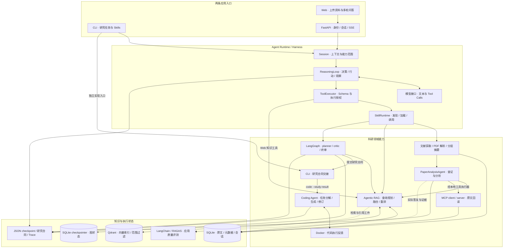
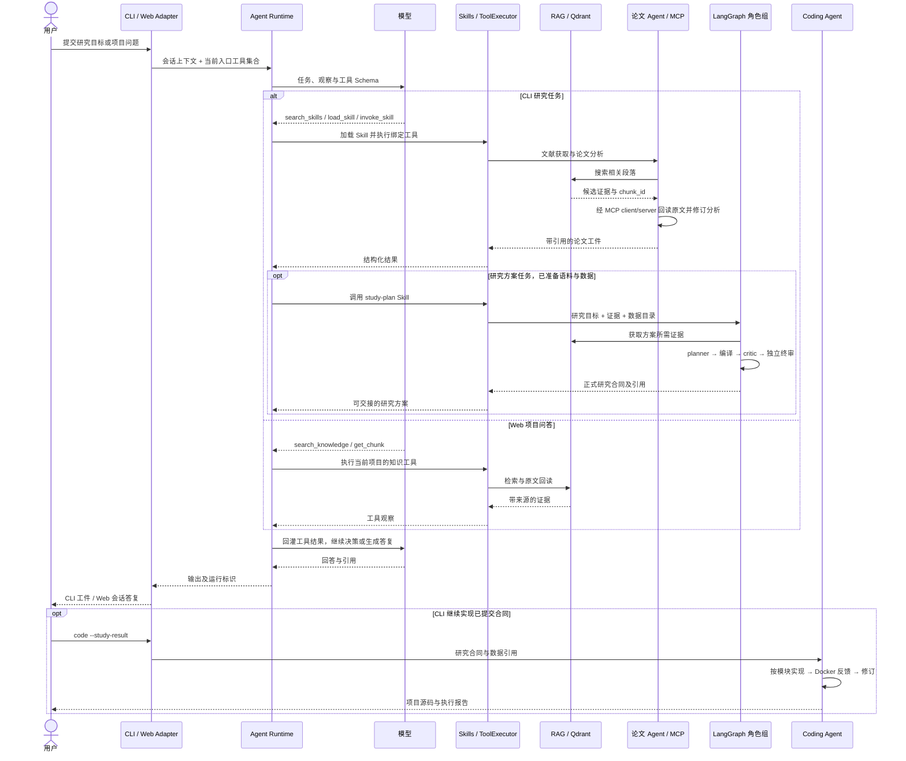

# 简介

**ResearchOps 是以科研智能体为应用场景的 Agent Runtime。** 它把模型推理、Tool Calling、Skills、Agentic RAG、LangGraph 多角色编排与 MCP 工具服务连接成一条可持续执行的任务链：用户提出研究问题，系统获取和组织证据，形成可追溯的回答或研究方案，并把结构化方案交给 Coding Agent。

项目采用“**外层 Harness + 内层 MicroAgent**”结构。外层负责阶段推进、工具权限、状态恢复和工件交接；内层的论文分析、规划、评审 Agent 各自持有提示词、上下文和工具，在有限循环中查证、修订并提交结果。模型决定局部下一步，宿主决定任务何时进入下一阶段。

| 能力 | 在 Runtime 中的作用 |
| --- | --- |
| Tool Calling 与 Skills | 通过 `search_skills → load_skill → invoke_skill` 按需发现和加载能力，调用统一的工具执行器 |
| RAG 与 Qdrant | 文档解析、结构化分块、Embedding、多路召回、融合重排、MMR 去重及原文引用回读 |
| LangGraph 与多 Agent | 组织 planner、critic 和独立终审的协作，按结果选择修订或提交，持久化图状态 |
| MCP client/server | 使用官方 Python SDK，以 stdio 连接只读论文服务，把工具结果送回 Agent 上下文 |
| 上下文与任务状态 | 角色隔离、论文分层摘要、按需回读、源码历史裁剪与 checkpoint 续接 |
| Coding Agent | 消费研究合同，按模块生成代码，并根据 Docker 中的执行反馈继续修订 |
| Eval 与可观测性 | 接入 LangChain/RAGAS，关联输入快照、引用、角色输出、工具事件与任务工件 |

CLI 面向研究任务与开发者工作流；独立 Web 让用户上传论文或笔记，并围绕这些资料连续提问、获取带来源的回答。两者共享模型接口、工具循环和领域服务，由入口适配器选择能力范围。文档入口：[运行指南](RUNNING.md) · [架构说明](docs/ARCHITECTURE.md) · [配置说明](docs/CONFIGURATION.md) · [应用结果](docs/PERFORMANCE.md) · [扩展指南](docs/EXTENDING.md)。

# 流程图

## Runtime 与领域组件



图中的合同交接由 CLI 的 `coding-plan` / `code --study-result` 入口承接。Web 使用项目知识工具集合；科研规划和 Coding 在 CLI 中开展。

## 组件协作泳道



# 安装与运行

以下命令在项目根目录以 PowerShell 执行。CLI 与 Web 可独立使用，也可以共用一个 Python 环境。

| 环境 | 用途 |
| --- | --- |
| Python 3.11+，推荐 3.12 | Runtime、CLI、FastAPI、本地 Embedding |
| 支持 Chat Completions 与 Tool Calling 的模型服务 | Agent 推理与结构化工具调用 |
| Docker Engine / Docker Desktop，Linux containers | Qdrant 服务和 Coding 执行环境 |
| Node.js 22 LTS、npm | 本地 Web 前端；Compose 部署由镜像提供 |
| 本地模型缓存 | SentenceTransformer 与 Cross-Encoder；首次使用时下载，可在 CPU 运行 |

## 路径一：CLI 研究智能体

安装 [requirements.txt](requirements.txt)，一次安装核心依赖：

```powershell
python -m venv .venv
.\.venv\Scripts\python.exe -m pip install -r requirements.txt
if (-not (Test-Path .env)) { Copy-Item .env.example .env }
```

依赖按职责声明在 [pyproject.toml](pyproject.toml)，`requirements.txt` 选择应用能力并载入 [requirements-eval.txt](requirements-eval.txt) 的评测兼容组合。主要依赖及用途如下；具体约束以这三个文件为准，`pip` 同时安装传递依赖。

| 依赖 | 提供的能力 |
| --- | --- |
| `FastAPI`、`uvicorn`、`PyJWT`、`httpx`、`python-dotenv` | HTTP API、登录令牌、服务请求与环境配置 |
| `langgraph`、`langgraph-checkpoint-sqlite` | 方案状态图、条件路由、SQLite 持久化与续接 |
| `mcp` | 官方 Python MCP client/server，stdio 工具发现与调用 |
| `qdrant-client` | Qdrant 向量写入、范围过滤与检索 |
| `PyMuPDF` | PDF 解析；Markdown / TXT 由应用直接处理 |
| `sentence-transformers`、`torch` | Embedding、Cross-Encoder 重排和本地推理 |
| `torchvision`、`timm`、`Pillow`、`numpy`、`scipy`、`pyarrow` | 图像数据适配、ViT 实现与 Coding 执行支持 |
| `ragas`、`datasets` | 答复、上下文及参考答案的应用质量度量 |
| `langchain`、`langchain-core`、`langchain-community`、`langchain-openai` | 宿主模型到 RAGAS 的 ChatModel / wrapper 适配 |
| `certifi`、`PyYAML` | HTTPS 证书与配置读取 |

SQLite 由 Python 标准库提供。`qdrant-client` 安装在虚拟环境中，Qdrant 服务需要按下文启动；Docker、Node.js 和模型权重分别准备。需要 OCR 与复杂版面解析时，可额外运行 `python -m pip install -e ".[docling]"`。只使用应用能力时也可安装 `python -m pip install -e ".[web,pdf,retrieval,datasets,coding,agent]"`；独立评测环境的安装方式见[评测说明](docs/EVALUATION.md)。

在 `.env` 填写 `RESEARCHOPS_MODEL_BASE_URL`、`RESEARCHOPS_MODEL_API_KEY`、`RESEARCHOPS_MODEL_NAME`。本地知识库可直接使用 `local` 向量后端；启用 Qdrant、论文 MicroAgent 和 MCP 时，按[运行指南](RUNNING.md#cli-启用-qdrant与论文-agent)启动服务并设置对应选项。

先用仓库内的研究简报体验入库与引用检索，再让 Agent 根据任务选择 Skill：

```powershell
.\.venv\Scripts\python.exe researchops.py --workspace knowledge_base/cli_research ingest docs/examples/research_brief.md
.\.venv\Scripts\python.exe researchops.py --workspace knowledge_base/cli_research search "LoRA rank 与数据划分"
.\.venv\Scripts\python.exe researchops.py --workspace knowledge_base/cli_research agent "查找当前知识库中的研究约束，附原文引用，并区分资料事实与拟开展的工作。"
```

获取真实论文可使用 `research`；已有语料与数据后通过 `plan-study` 调用 LangGraph，再交接 Coding：

```powershell
.\.venv\Scripts\python.exe researchops.py --workspace knowledge_base/cli_research research "ViT 少样本分类中的 LoRA 与视觉适配器" --max-queries 2 --limit-per-query 4 --max-downloads 2
.\.venv\Scripts\python.exe researchops.py skills
.\.venv\Scripts\python.exe researchops.py plan-study --help
.\.venv\Scripts\python.exe researchops.py code --help
```

完整的数据准备、合同交接与恢复命令见[CLI 运行指南](RUNNING.md#路径一cli)。文档中的 `knowledge_base/` 由命令创建，论文与模型请求按实际任务获取。

## 路径二：Web 上传资料与对话问答

Web 是一个**围绕自己的论文和笔记聊天的浏览器界面**：上传资料后，可以让 Agent 查找原文依据、整理观点、比较不同论文的方法，并继续追问。这里的“项目”是资料的分组名，例如填写 `vit-peft`，把同一课题的论文放在一起；提问时，Agent 检索当前项目中的资料。

- **上传资料**：支持 PDF、Markdown 和 TXT，单文件不超过 20 MiB；系统解析、分块并加入当前项目的检索范围。
- **基于资料提问**：例如“这两篇论文的 LoRA 设置有哪些差异？请附原文依据”，Agent 检索相关段落，必要时回读原文，在回答中给出来源标识和证据片段。
- **连续追问**：在同一页面会话中接着问“只整理与显存开销有关的内容”，Agent 沿用前文；“新建对话”清空聊天上下文，修改项目名则切换资料范围并开始新对话。

浏览器入口提供资料阅读与问答；研究方案编排和 Coding 源码交付通过并列的 CLI 入口运行。

Web 采用独立 FastAPI 后端和 Vite 前端。使用上面的 Python 环境，在项目根目录准备 Web 配置：

```powershell
if (-not (Test-Path .env.web)) { Copy-Item .env.web.example .env.web }
npm.cmd --prefix frontend ci
```

在 `.env.web` 设置登录密码 `RESEARCHOPS_WEB_PASSWORD` 和至少 32 字节的随机 `RESEARCHOPS_JWT_SECRET`；在 `.env` 设置模型服务。两个终端分别运行：

```powershell
.\.venv\Scripts\python.exe -m uvicorn researchops_api.main:create_app --factory --app-dir src --host 127.0.0.1 --port 8000
```

```powershell
npm.cmd --prefix frontend run dev
```

打开 `http://127.0.0.1:5173`，填写用户标识和配置的访问密码。一次完整使用流程是：在“项目”输入框填写 `vit-peft` → 依次上传两篇论文并等待导入完成 → 在“研究问题”中输入比较问题 → 阅读回答中的来源与原文依据 → 继续追问。API 文档为 `http://127.0.0.1:8000/docs`。SSE 发送任务心跳与终态答复，会话历史由服务端保存。

使用 Docker 部署 Web 时，准备相同的 `.env` 和 `.env.web`，运行：

```powershell
docker compose --env-file .env.web up -d --build --wait
```

访问 `http://127.0.0.1:3000`。Compose 提供 Nginx 与 FastAPI，默认采用 PyMuPDF 和轻量本地检索，数据保存到 `web_workspace/`。本地 Python 路径支持神经检索与 Qdrant；配置与部署说明见[Web 运行指南](RUNNING.md#路径二web)。

# 性能与结果分析

结果围绕 Runtime 服务应用的能力展开：检索是否更准确、证据是否能支撑回答、上下文是否更紧凑，以及研究目标是否能交接为结构化方案。下表来自已保存的同条件记录；语义评分采用独立模型调用产生的 **LLM 银标**。

**数据集与运行规模。** 文献检索及证据支撑对照使用自建的 ViT 参数高效微调论文语料，共 **94 篇论文、7,757 段原文、6 个研究主题、12 个问题**；增量维护从 87 篇扩展到 94 篇。Coding 前的交付率来自 **6 个同领域新组合研究任务**，其中 5 个围绕 DTD / Oxford-IIIT Pet，1 个围绕 CIFAR-100 / Flowers-102，度量终点是研究合同与冻结规格交付。

联合 Coding 案例使用 **DTD（47 类，原始清单 5,640 张）与 Oxford-IIIT Pet（37 类，本地准备清单 7,349 张）**作为数据交接基础；实际代码执行采用两者的真实图像小批量、CPU tiny-ViT、32 × 32 输入和 batch size 2，完成第 2 步到第 3 步的续训。合同中的 **36 项计划任务**用于研究配置和调度交接；图像清单大小表示可用数据范围，完整多随机种子训练属于后续研究执行范围。下表的检索与方案指标分别以论文问题集和研究任务集为统计单位。

| 应用能力 | 实测结果 | 统计范围 |
| --- | --- | --- |
| 融合检索排序 | nDCG@10 **0.690 → 0.749**；新增论文 Recall@10 **43.75% → 50.69%** | 94 篇语料、12 问，论文去重后按问题宏平均；新增论文子集为 7 篇 |
| 证据支撑与方案组织 | 全部输出事实获原文充分支持 **75.51% → 96.15%**；方案可用性 **2.42 → 4.00 / 4** | 固定语料同轮匿名评审，对比旧完整链路与 Fusion 完整链路 |
| 按需加载 Skills | 初始提示 token 减少 **68.7%**，平均总 token 减少 **57.4%** | lazy / eager 两个完成运行重复对照，度量上下文组织收益 |
| 增量知识库维护 | 旧向量复用 **93.2%**；新增编码相对全量重建约快 **12.7 倍** | 同机扩库：复用 7,227 段、新增 530 段，增量 21.92 秒、全量 278.83 秒 |
| Coding 前端到端交付 | 同领域 6 个新组合任务交付率 **83.3%（5/6）**；同题修复复验 **100%（6/6）** | 终点为经编译和独立评审的冻结规格；复验使用已暴露题目 |
| 多组件业务交接 | Qdrant、MCP、LangGraph 与 Coding 在同一任务链形成可关联的论文、方案及源码工件 | 联合案例完成 36-job 方案交接与 6 个代码模块，执行范围为 CPU tiny-ViT |

这些结果分别支持融合检索、证据组织、按需上下文和结构化交付的设计选择。范围、指标定义及数字来源见[应用结果说明](docs/PERFORMANCE.md)；RAGAS 接口与任务分层策略见[评测说明](docs/EVALUATION.md)。

# 工作流讲解

## 1. 入口与上下文装配

一次请求从入口适配器开始。CLI 以当前本地进程权限运行，`--workspace` 确定数据库和工件根目录，`--allow-root` 声明额外可读路径；宿主为本次任务创建 `session_id` 和 `run_id`。Web 在登录时校验共享密码并签发 JWT，以令牌中的用户命名空间、`project_id` 和 `session_id` 定位项目与会话；服务端核对会话归属，从 `web_workspace/web_state.db` 取回历史消息，再创建本次运行。

宿主随后装配模型接口、System Prompt、Session 和 Tool Schema。CLI 的 `agent` / `research` 入口提供 `search_skills → load_skill → invoke_skill`：先发现能力元信息，再加载 Skill 正文及参数 Schema，最后按加载 hash 调用宿主绑定函数。文档入库、证据检索、文献获取和方案规划由不同 Skill 承接。Web 项目问答仅装配 `search_knowledge`、`get_chunk`、`answer_with_evidence`，handler 绑定当前项目。`plan-study` 和 `code` 也支持 CLI 直接进入对应应用服务。

## 2. 模型决策与工具路由

ReasoningLoop 把任务、会话消息、已有工具观察和当前 Agent 可见的工具 Schema 一起发送给模型。模型通过 Tool Calling 返回工具名与 JSON 参数表达行动意图；执行发生在宿主。ToolExecutor 先通过 ToolPolicy 检查工具是否存在、是否属于该 Agent 的允许集合、是否满足工具的角色和确认要求，再检查参数字段与类型，把执行上下文交给注册的 handler。

领域 handler 进一步检查文件路径、项目或论文归属。检索时，RAG 从 SQLite 取词法候选，从 Qdrant 取带范围过滤的 dense 候选，结合多查询融合、Cross-Encoder 重排和 MMR，返回稳定 `chunk_id`、来源与预览。ReasoningLoop 将执行结果以对应 `tool_call_id` 的观察消息交还模型，继续“决策 → 行动 → 观察”，直到生成答复或达到宿主设定的停止条件。工具事件写入工作区的 `runs/<run_id>/trace.jsonl`。

## 3. 局部 Agent 执行

以论文分析为例：文献获取服务完成全文解析和入库、准备好可分析段落后，在启用 `RESEARCHOPS_PAPER_ANALYZER_MODE=micro` 时调用 PaperAnalysisAgent。宿主为它创建独立 System Prompt、论文范围、工具集合和局部上下文；MicroAgentRunner 承接有限轮次的推理与反思。论文 Agent 可调用 `search_paper_chunks` 定位证据、`get_paper_chunk` 回读原文、`validate_paper_analysis` 检查候选分析。

配置 `RESEARCHOPS_PAPER_READ_TRANSPORT=mcp` 后，`get_paper_chunk` 的本地 handler 调用官方 MCP client，由宿主启动绑定当前数据库、论文和允许段落的 stdio server。client 完成 `initialize`、`tools/list` 和 `tools/call`，server 再次核对归属后只读 SQLite，返回原文、页码和来源。结果经 ToolExecutor 回到论文 Agent 的局部消息中；validator 将字段、引用范围、是否实际回读等反馈交给后续轮次，Agent 据此修订，提交带引用的结构化分析。协议记录、分析工件和 JSON checkpoint 保存在对应工作区。

多 Agent 协作以正式工件为边界：论文 Agent 产出分析和引用，planner 消费证据提出方案，critic 与 final_review 在各自上下文中评审候选。宿主负责触发角色和传递工件，每个角色内部拥有自己的工具循环；跨角色的协作顺序由方案图组织。

## 4. LangGraph 状态流转

当用户通过 `study-plan` Skill 或 `plan-study --orchestration langgraph` 提交研究目标，并指定已准备的论文语料和数据目录时，宿主进入方案子图。`retrieve` 先组织证据；`planner` 提出候选；`compile_gate` 由宿主将候选编译为研究合同并检查约束；候选就绪后交给 `critic`，通过后进入独立的 `final_review`。`decide` 汇总反馈，选择回到 planner 修订，或进入 `submit` 保存结果；正式合同随被接受的候选提交。

所有条件边都由宿主代码定义：编译反馈进入 decide，评审反馈驱动修订，接受、终止条件或候选次数上限决定提交时机。Agent 返回结构化判断，宿主据此路由。LangGraph 按 `thread_id` 将节点状态、下一步位置和中间工件引用保存到方案目录的 `graph_checkpoints.sqlite`；角色内部消息另存 JSON checkpoint。恢复同一输入任务时，先定位图进度，再由对应角色续接局部状态。

## 5. 持久化与数据分层

CLI 的根目录由 `--workspace` 指定；Web 的项目根目录是 `web_workspace/users/<user>/projects/<project>/`。数据按职责保存：

| 数据 | 保存位置 | 写入与读取时机 |
| --- | --- | --- |
| 原文段落、页码、论文元数据与引用映射 | 工作区的 **SQLite**：`researchops.db` | 入库服务解析、分块时写入；检索和 MCP 原文回读时读取；下载源文件保存在工作区资料目录 |
| Embedding 向量及项目 / 论文范围 payload | **Qdrant** collection，服务数据位于 Docker volume `researchops-qdrant-data` | 入库或增量索引时写入；dense 召回时查询；SQLite 保留事实原文及本地向量缓存 |
| 方案图状态与下一节点 | 方案目录中的 **SQLite checkpointer**：`graph_checkpoints.sqlite` | 图执行期间保存；按 `thread_id` 恢复 |
| 局部 Agent 消息、轮次、候选与停止位置 | **JSON checkpoint**：角色目录下的 `state.json` | MicroAgent 执行中保存，局部续接时读取 |
| Coding 计划、模块进度与执行反馈 | `coding/<plan_id>/` 下的 JSON checkpoint 和报告 | 源码生成、沙箱执行与修订期间保存 |
| Web 会话消息与请求状态 | `web_workspace/web_state.db` | 接收请求、执行完成时保存；下次会话和状态查询时读取 |
| 工具和角色事件 | 各工作区 / 方案目录的 `runs/<run_id>/trace.jsonl` | 执行期间记录，并关联会话、角色与工件 |

Qdrant 是可配置的向量后端，使用上述链路时设置 `RESEARCHOPS_VECTOR_BACKEND=qdrant`；轻量本地使用可选择 `local`。原文事实、向量索引、图进度和局部消息分别管理，checkpoint 与任务输入绑定，使中断后的继续执行有明确位置。

## 6. 最终交付（Coding 链路）

LangGraph 的提交结果落在 `<方案工作区>/studies/<study_id>/`，其中 `result.json` 指向正式方案与 `frozen_spec.json`。用户通过 CLI 的 `coding-plan --study-result <result.json>` 构建实现计划，再用 `code --study-result <result.json>` 启动 Coding Agent。合同适配器读取研究约束、数据引用和任务定义，生成模块依赖与允许输出文件清单。

Coding Agent 根据计划写入源码、调用 Docker 沙箱获取执行反馈，再根据反馈修订。沙箱以断网、只读源码与输入挂载以及独立可写输出目录约束运行；宿主确认当前源码对应的执行结果后记录交付状态。最终源码保存到 `<Coding工作区>/coding/<plan_id>/project/`，计划、JSON checkpoint 和执行报告保存在其上一级任务目录。恢复同一任务使用 `--resume`，沿用已保存的模块进度与工件。

# 关键设计与决策取舍

**科研场景适合确定性骨架与局部自主结合。** 文献获取、证据组织、研究规划和实现交接具有明确依赖；原文解释、方案评审和代码修订需要灵活推理。因此外层保留阶段控制，内层把自主能力放在具体任务节点，多 Agent 通过正式工件协作。

**自建 Runtime 与 LangGraph 分工。** 自建内核统一模型接口、Tool Calling、Skills、权限和 Trace；LangGraph 专注方案子流程的条件路由与持久化编排。这种划分便于复用业务函数，也便于比较图编排与宿主循环的使用边界。

**SQLite 保存事实，Qdrant 提供向量召回。** 原文、元数据和引用位置统一留在 SQLite；Qdrant 承担带范围过滤的向量检索。Embedding revision、内容 hash 和版本化 collection 共同维护索引一致性，知识库扩展时复用已有向量。

**Tool Calling、Skills 和 MCP 各司其职。** Tool Calling 表达模型的行动意图；Skills 提供按需加载的领域操作说明；MCP 提供宿主与工具服务间的发现、调用协议。三者在同一执行链组合，宿主统一管理执行边界与资源开销。

**按任务选择推理深度。** 同条件任务对照为直接生成、有限修订和主动查证提供了选择依据：结构明确的问答采用有限修订，原文解释和方案评审使用局部工具循环。应用保留可配置的论文分析路径，把工具循环部署在具有查证需求的节点；研究投入集中于组件交接与可复用接口，让局部自主服务完整任务。

**用有代表性的运行回答架构问题。** 科研任务需要论文获取、模型评审和代码执行，完整多数据集、多随机种子训练还需要显著计算资源。项目因此以固定语料对照、组件消融、Coding 前端到端交付及 CPU 实现案例构成证据，集中展示检索、上下文与执行协作的价值；更大规模研究作为独立扩展方向。银标评价覆盖方案与证据质量，模型训练收益使用实际训练结果另行衡量。

# 许可证

本项目采用 [MIT License](LICENSE)。包含的第三方代码保留对应许可证，例如 [TaleClaw 许可证](src/researchops/vendor/taleclaw/LICENSE)；模型权重、论文和数据集分别遵循其来源的使用条款。
