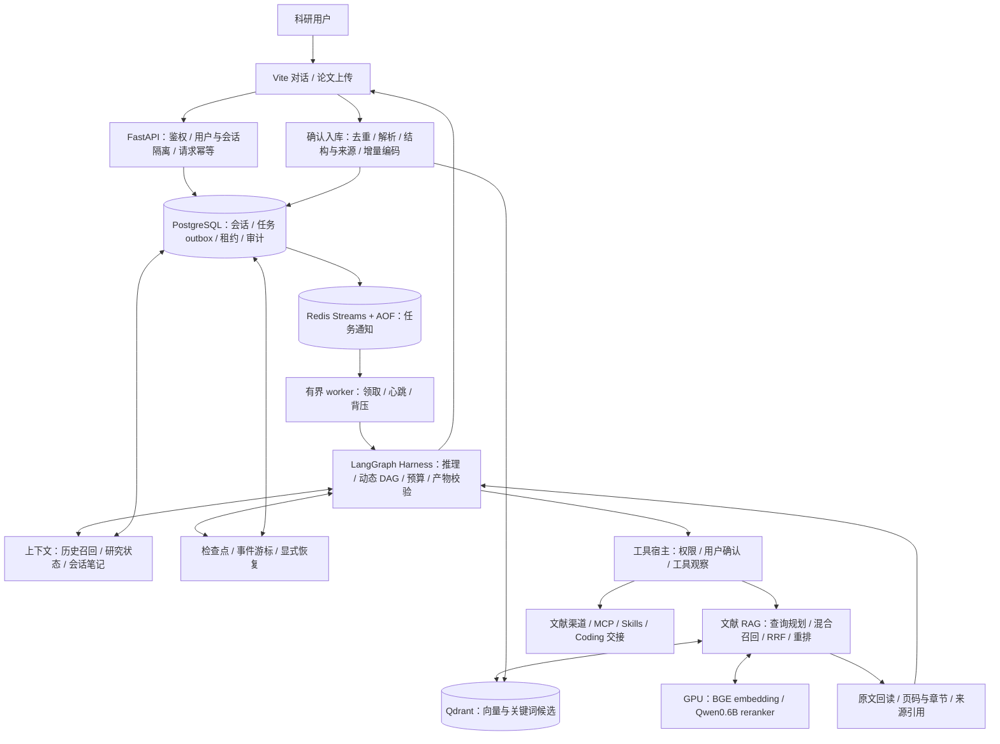
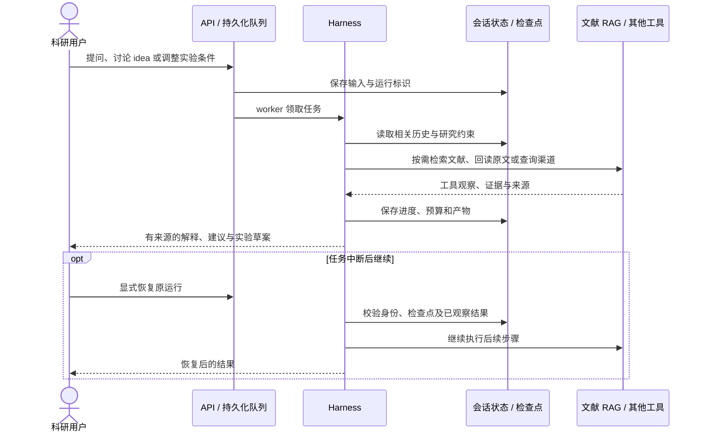

# ResearchClaw：面向个人论文库的科研 Agent

ResearchClaw 是围绕作者日常科研需求开发的开源科研 Agent，主要服务于时间序列压缩与误差控制方向。它将论文阅读、文献检索、idea 讨论和实验方案设计放进同一个对话环境，让持续积累的论文成为能够检索、追问和核查的研究资料。

系统以 **Python / LangGraph Harness** 为运行主体：模型理解问题、选择工具并组织回答，宿主管理上下文、任务依赖、执行预算、日志与检查点。**文献 RAG 是 Harness 调用的一类工具**，与文献获取、原文读取、MCP 和 Skills 共同支撑研究过程。

v0.5 将原有 204 篇与新增 200 篇论文统一处理，形成 **404 篇 PDF、75,717 个检索子块**的文献实验资产，完成 GPU embedding、小模型重排、LoRA 排序微调和公开原题评测；后端采用 **PostgreSQL + Qdrant + Redis Streams**，支持多用户会话、持久化任务分发与中断恢复。

## 1. 项目概览

对于使用者，ResearchClaw 的核心价值是把“找过哪些论文、证据在哪里、研究条件改过什么”连接起来。例如，讨论一种压缩方法时，可以追问它的误差保证；提出一个改进想法时，可以查找相近工作；调整设备条件后，也可以继续修改基线和实验指标。

主要功能包括：

- **论文问答与来源定位**：按自然语言检索方法、假设与适用条件，关联论文、页码、章节和原文片段。
- **Idea 分析与研究建议**：结合已有工作讨论重合点、改进方向、研究假设和验证路径。
- **文献发现与增量入库**：生成学术检索式、查询公开渠道，接收上传的 PDF，经确认后更新知识库。
- **实验方案与基线设计**：围绕研究目标、设备和时间预算，讨论数据划分、指标、基线与消融。
- **连续对话与研究状态**：维护会话历史、研究约束和确认笔记，支持创建、命名、继续与删除会话。
- **可恢复的工具执行**：通过权限校验、用户确认、预算账本与检查点管理较长任务，提供执行审计和显式恢复入口。

从开发者视角看，系统采用 **LangGraph 单 Agent + 动态任务 DAG**。简单问题直接回答，有依赖的任务按需拆分；工具观察与用户反馈进入后续推理，任务产物经过校验后保存。FastAPI 提供统一 API，独立 Vite 前端负责对话交互。

## 2. 系统架构与使用流程

### 系统架构



### 用户使用流程



## 3. 从科研问题到可核查的回答

### 理解问题，找到合适的检索方向

用户可以用中文描述研究问题。系统结合语境澄清概念，生成适合英文论文的查询，并按需扩展术语或拆解子问题。例如，“压缩后误差能不能保证”可能对应最大绝对误差、相对误差或平均误差；明确度量后，再检索对应方法与实验条件。

> “我关心的是每个采样点的最大偏差，论文里一般用什么术语描述这种保证？”

### 把论文变成有来源的知识

入库过程结合内容哈希去重、文本清洗、质量分级与来源记录。v0.5 的统一 R8 方案在同章节、页面和栏位内组织相邻短段落，使用完整 tokenizer 输入控制子块长度，并保留父子关系、字符跨度、页码与版面信息。404 篇论文按相同规则完成 chunking 和 embedding，便于受控比较与后续重建。

小块用于匹配问题，父级上下文用于理解方法与前提；Markdown 与文档树表示进一步提供章节导航和实验入口。新增资料按内容变化更新，已有解析和向量可以复用。

> “这篇 PLA 论文的误差约束针对原始采样点，还是重建后的整条曲线？请给出原文位置。”

### 兼顾语义与关键词，优先呈现有效证据

文献工具结合 **BGE-small-en-v1.5 向量召回、BM25、RRF 融合和 Qwen3-Reranker-0.6B 重排**。GPU 服务通过本地 CUDA 或受控 SSH 通道提供 embedding 与相关性评分；指定论文的问题可以按论文范围检索，再回读正文和引用。

默认实验配置为 **R8/base**。重排层同时提供硬标签监督 LoRA 和 GPT 教师排序蒸馏 LoRA，按显式配置加载适配器，保留基座、训练数据、checkpoint 和权重哈希的对应关系。

> “Gorilla 和 Chimp 分别利用了浮点数据的什么特征？我应该先读哪篇理解它们的区别？”

### 从文献证据延伸到 idea 与实验草案

Harness 根据问题调用文献工具，将找到的条件、方法和实验观察组织成研究建议。用户可以围绕已有设计追问重合点，或把一个想法收敛成数据集、基线、评价指标和消融实验；文献获取和 Coding 交接通过明确的确认入口衔接。

> “用局部波动决定分段位置，再统一保证最大绝对误差，应如何选择基线和消融？”

### 在连续讨论中保留研究约束

上下文由最近完整轮次、问题驱动的历史召回、对话锚点、显式研究状态和确认笔记组成。设备、误差指标和基线选择可以持续使用；用户更正条件后，后续建议沿用新的研究决定。

> “把误差上限改为 0.004，设备条件沿用本会话之前确认的配置，重新检查实验指标。”

### 按需使用工具，保留可恢复的研究进度

MCP 提供论文元数据与原文读取接口，Skills 封装文献获取、证据检索和研究规划。宿主统一管理工具权限、调用预算、执行记录与产物校验。

会话任务与用户输入在同一数据库事务中保存，通过 outbox 和 Redis Streams 分发。worker 使用租约、心跳与 fencing 校验提交权限；运行中断后保留检查点，经显式恢复继续执行。请求幂等键、审计事件游标和队列容量控制共同支撑多用户使用。

## 4. 启动方式

项目使用 Python 3.12、FastAPI 和独立 Vite 前端，Docker 提供 PostgreSQL、Qdrant 与 Redis。配置字段见 [.env.example](.env.example)、[.env.web.example](.env.web.example) 和 [.env.harness.example](.env.harness.example)，模型与数据库凭据保存在本地环境文件。

在项目根目录安装后端依赖、准备配置并启动基础设施：

```cmd
.venv\Scripts\activate
python -m pip install -e ".[web,agent,durable,pdf,retrieval]"
docker compose --env-file infra\.env -f infra\compose.yaml up -d
docker compose -f infra\compose.harness.yaml up -d redis
```

本地开发后端启用持久化队列后启动：

```cmd
set RESEARCHCLAW_REDIS_URL=redis://127.0.0.1:6379/0
python scripts\serve_backend.py
```

在另一终端启动前端：

```cmd
npm.cmd --prefix frontend ci
npm.cmd --prefix frontend run dev
```

访问 `http://127.0.0.1:5173`，API 文档位于 `http://127.0.0.1:8011/docs`。首次创建账号时使用本地注册邀请码，并设置个人密码。GPU 检索服务由 `scripts/gpu_online.py`、`scripts/serve_gpu_models.py` 与相应配置管理。

无 GPU 的演示环境使用独立 CPU 入口，继续复用 PostgreSQL、Qdrant、Redis 与现有生成 API：

```cmd
set RESEARCHCLAW_CPU_THREADS=4
python scripts\serve_backend_cpu.py
```

CPU 入口使用本地 BGE-small embedding 与 MiniLM 小模型重排，模型首次使用前需准备权重缓存；配置参考 [.env.cpu.example](.env.cpu.example)。运行产物保存到较短的 `.cpu-runtime/` 目录，适合 Windows 演示。已有 GPU 启动入口和 Qwen/LoRA 配置继续保留。可通过 `set RESEARCHCLAW_CPU_EVIDENCE_REVIEW=true` 在启动前启用 API 证据充分性复核；该步骤对候选证据排序并持久化请求记录，失败时保留 CPU 小模型排序。前端启动方式及访问端口相同。

容器部署使用 [Compose 配置](infra/compose.harness.yaml) 和 [Dockerfile](backend/Dockerfile.harness)。根据模板准备 `.env.harness` 后启动双 API 进程，每进程配置有界队列 worker：

```cmd
docker compose -f infra\compose.harness.yaml --profile app up -d --build
set RESEARCHCLAW_API_TARGET=http://127.0.0.1:8000
npm.cmd --prefix frontend run dev
```

容器后端使用持久化命名卷保存运行文件，复用 PostgreSQL/Qdrant 服务；`/api/v1/ready` 检查数据库与队列连接。

## 5. 评估与架构取舍

评估围绕文献证据检索、回答质量、会话上下文与持久化执行展开。公开原题、领域银标、模型训练和基础设施负载分别保存协议与结果，使用各自的数据划分和指标。

### 论文检索与回答质量

主要检索对照采用 **QASPER 官方 test 的固定 64 道原题、32 篇论文**，保留原始问题、答案和证据。评测伴随库将官方全文适配为可追踪段落，使用一致的 embedding 输入与候选生成规则，并加入 404 篇领域论文。给定论文与全库检索分别统计，按已知论文家族隔离训练候选和测试资料。

| 指定论文检索，64 道公开原题 | Recall@5 | MRR@5 | nDCG@5 |
|---|---:|---:|---:|
| BM25 | 0.4883 | 0.4029 | 0.3991 |
| BGE-small | 0.6120 | 0.4685 | 0.4858 |
| RRF 融合 | 0.6146 | 0.4539 | 0.4797 |
| RRF + MiniLM | 0.6471 | 0.4737 | 0.5049 |
| RRF + Qwen0.6B | 0.7435 | 0.5581 | 0.5932 |
| RRF + 硬标签 LoRA | 0.7096 | 0.6125 | 0.6101 |
| RRF + GPT 排序蒸馏 LoRA | 0.7643 | 0.5945 | 0.6149 |

全库同候选对照中，Qwen 相对 MiniLM 的 nDCG@5 为 **0.2865 vs 0.2201**；硬标签 LoRA 相对原 Qwen 的 MRR@5 为 **0.3266 vs 0.2714**，相对提高约 **20.35%**，32 个论文家族的配对 bootstrap 95% 区间为 `[0.0174, 0.0982]`。

训练使用 **Qwen3-Reranker-0.6B + q/v 投影 rank-16 LoRA**，比较硬标签排序监督与 GPT 教师相关性等级监督。399 组训练资料包含 QASPER、SciDocs 和时间序列文献银标；两臂分别完成 2394 个 CUDA 优化步，使用验证集选择 checkpoint。数据划分、教师输出、loss、适配器身份与原题推理结果可关联核查。

v0.5.1 在保留 GPU 配置的基础上补充 CPU 运行入口，并在另一批预先冻结的 **16 篇论文、32 道 QASPER 官方 test 原题**上验证证据选择。该轮采用给定论文适配协议，保留原始问题与段落证据；BGE、MiniLM 本地 CPU 运行，可选 API 复核仅根据问题与 RRF top40 候选判断可回答性。论文家族与已知训练资料、历史测试题隔离，按固定 hash 顺序选择具备可映射证据的可回答原题。

| CPU 检索对照，32 道公开原题 | Recall@5 | Precision@1 | MRR@5 | nDCG@5 | Precision@5 |
|---|---:|---:|---:|---:|---:|
| BM25 | 0.3783 | 0.1250 | 0.2547 | 0.2706 | 0.1063 |
| BGE-small | 0.5449 | 0.3750 | 0.4688 | 0.4517 | 0.1688 |
| RRF | 0.5241 | 0.3438 | 0.4594 | 0.4259 | 0.1563 |
| RRF + CPU MiniLM | 0.5241 | 0.2813 | 0.4479 | 0.4283 | 0.1500 |
| RRF + API 证据复核 | **0.8506** | **0.5625** | **0.7188** | **0.7510** | **0.2938** |

原候选池 Recall@40 为 **0.9762**，优化集中于将可回答证据排到前列。Precision@1 衡量首条是否命中官方证据，Precision@5 按五条返回结果计分；这批题的官方证据数对应 P@5 平均理论上限 **0.3563**，两项按原定义分别保留。

生成侧采用 **RAGAS 0.4.3**，预先固定每篇一道、共 **16 道官方原题**，两臂使用相同生成模型与提示、top5 完整证据、4096-token 证据预算和 600-token 输出预算：

| CPU 原题生成对照 | faithfulness | answer relevancy | context precision | context recall |
|---|---:|---:|---:|---:|
| RRF + CPU MiniLM | 0.9911（15/16） | 0.7117（16/16） | 0.7173（15/16） | 0.7083（16/16） |
| RRF + API 证据复核 | **0.9268（15/16）** | **0.8206（16/16）** | **0.9540（15/16）** | **0.9375（16/16）** |

括号为有效/尝试评分数；表内是各臂有效均值，4 项 API 超时记录随原题结果保留。论文家族配对分析中，context precision 差值为 **+0.2536**，95% bootstrap 区间 `[0.0967, 0.4390]`；context recall 为 **+0.2292**，区间 `[0.0625, 0.4375]`。相关性差值与 faithfulness 差值的区间跨零。该配置通过补全和优先选择直接证据改善回答覆盖，生成及复核复用已有大模型 API；GPU 小模型微调结果按上面的独立训练协议展示。

### 增量构建效率

v0.4 增量实测从 194 份论文库补入 12 份 PDF，经内容去重新增 10 份，扩展至 204 份：构建约 **101.16 秒**，新增 618 个检索片段，复用 **10,337 条向量**；BM25 刷新约 4.04 秒，无内容变化检查约 0.49 秒。v0.5 在统一规则下重建 404 篇 R8 语料，GPU 索引构建约 **113.6 秒**，完整输入长度控制为最多 500 个 BGE tokens。

### 单会话上下文与记忆

采用公开 **LongMemEval 全部 156 道单会话 oracle 问题**，在相同模型、提示和 4096-token 窗口预算下，对比“最近轮次 + 关键词触发摘录”与“问题驱动历史召回 + 对话锚点”。银标正确率由 **48.1% 提高至 86.5%**；其中此前未参与评估的 132 题为 **49.2% → 87.9%**。科研硬约束进一步由显式 Session State 与确认笔记保存。

### Agent 架构对照

v0.4 在 24 个本地科研任务上比较 ReAct 工具循环、Planner/Worker/Reviewer 三角色和 LangGraph 单 Agent：

| 架构 | 银标任务成功率 | 平均耗时 | 平均实际 tokens |
|---|---:|---:|---:|
| ReAct 工具循环 | 91.7% | 51.94 秒 | 19,905 |
| Planner / Worker / Reviewer | 79.2% | 103.70 秒 | 43,130 |
| LangGraph 单 Agent + 动态 DAG | 95.8% | 50.45 秒 | 21,133 |

项目采用单 Agent 集中维护研究语境，将执行权限、预算、状态校验与恢复交给 Harness。v0.5 进一步参考 DeepSeek Harness 的事件、上下文与宿主管理思路，完善持久化执行链条。

### 多用户、故障恢复与部署

最终版本以确定性模型执行真实 HTTP、PostgreSQL、Redis 与 LangGraph 负载协议：**32 个用户身份、64 个并发 HTTP 客户端、128 次运行全部完成**，256 次跨用户运行/审计读取均返回隔离响应。功能负载阶段吞吐 **0.8608 runs/s**，提交 P95 **1.8601 秒**，含排队、轮询和用户项目冷初始化的终态 P95 **144.3989 秒**。

进程丢失后的租约过期、显式检查点恢复、请求幂等、事件重读、取消与 Redis AOF 重启均通过验证。最终 Linux 镜像以双 API 进程完成真实模型调用与容器重启后的结果读取；定向工程回归 **28 项通过**。原始协议、成功记录、故障日志与源码哈希按版本封存。

## 6. 代码组织

```text
src/researchclaw/             核心实现
├── harness/                 Agent 运行、上下文、状态与执行治理
├── knowledge/               文献 RAG、GPU 检索接口与重排适配器
├── papers/                  文献渠道、下载与解析
├── integrations/            MCP 等工具集成
└── coding/                  Coding Agent 适配与实验交接

backend/src/researchclaw_api/ API、鉴权、会话、outbox 与 Redis worker
frontend/                    独立对话入口
scripts/                     启动、用户检索、GPU 服务与运行维护
config/                      项目配置
infra/                       PostgreSQL / Qdrant / Redis 与容器部署
skills/                      可复用的科研技能
```

运行代码与离线训练、评测、标注资料按职责组织；本地环境文件保存模型和基础设施连接配置。

## 7. 设计定位与后续方向

ResearchClaw 将持续积累的论文、带来源的问答、研究状态与可恢复的工具执行连接起来，服务于理解方法、讨论 idea 和准备实验草案等日常科研活动。后续围绕实际阅读体验扩展段落级证据标注、跨篇条件对齐、交互流式输出与部署可观测性，并研究适合不同文档结构的导航和检索策略。

项目按 MIT 协议开源。欢迎围绕文献工具、Harness、训练评测与部署提出 issue 或贡献改进。
