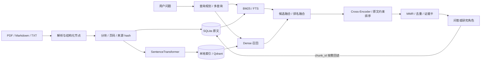
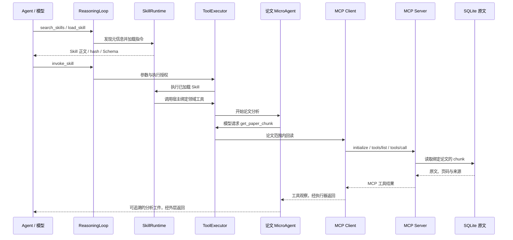
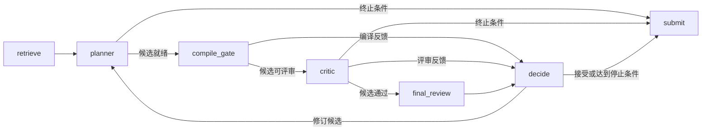

# Agent Runtime 架构

ResearchOps 把科研智能体建在可复用的模型与工具执行内核之上。Runtime 管理 Session、Tool Calling、Skill 加载、角色执行、checkpoint 和 Trace；科研服务提供文献、证据、研究合同和实现交接。入口与领域能力通过 adapter 和受治理工具连接。

## 组件职责与源码导航

| 层次 | 组件 | 职责 | 主要实现 |
| --- | --- | --- | --- |
| 入口 | CLI / FastAPI | 接收任务、选择项目和会话、声明可用能力 | [cli.py](../src/researchops/application/cli.py)、[main.py](../backend/src/researchops_api/main.py) |
| 应用装配 | ResearchOpsApp | 绑定模型、存储、工具与 Skills | [workflow.py](../src/researchops/application/workflow.py) |
| 通用推理 | ReasoningLoop | 模型决策、工具执行、观察回灌与最终答复 | [runtime.py](../src/researchops/harness/runtime.py) |
| 局部自主 | MicroAgentRunner | 独立上下文、结果校验、反馈修订、角色恢复 | [micro.py](../src/researchops/harness/micro.py) |
| 能力加载 | SkillRuntime / SkillLoader | 元信息发现、正文加载、版本绑定与工具调用 | [skills/](../src/researchops/harness/skills/) |
| 工具边界 | ToolRegistry / ToolPolicy / ToolExecutor | Schema、可见性、执行授权和结构化结果 | [runtime.py](../src/researchops/harness/runtime.py) |
| RAG | Hybrid / Evidence / Fusion Retriever | 多路召回、排名融合、原文约束重排与证据组织 | [knowledge/](../src/researchops/knowledge/) |
| 向量索引 | DenseVectorBackend | 本地精确检索和 Qdrant 服务端索引 | [vector_backend.py](../src/researchops/knowledge/vector_backend.py) |
| 文献 Agent | PaperAnalysisAgent | 论文范围内搜索、原文回读、引用校验和分析 | [analysis_agent.py](../src/researchops/papers/analysis_agent.py) |
| 工具服务 | Paper MCP client/server | 官方 SDK stdio、论文绑定、原文工具与协议记录 | [paper_mcp.py](../src/researchops/integrations/paper_mcp.py) |
| 角色编排 | StudyWorkflow / StudyRoles | LangGraph 路由、planner、critic、独立终审和提交 | [study_graph.py](../src/researchops/orchestration/study_graph.py)、[study_agents.py](../src/researchops/experiments/study_agents.py) |
| 实现执行 | CodingApplication | 合同到模块计划、源码生成、执行反馈和续接 | [coding/](../src/researchops/coding/) |
| 应用评测 | RAGAS / LangChain adapter | 实际答复与上下文的指标适配 | [ragas_adapter.py](../src/researchops/evaluation/ragas_adapter.py) |

## 两条入口，共用运行内核

CLI 以本地进程权限运行，工作区和 `--allow-root` 确定可访问的资料范围；宿主为任务创建 Session 与运行标识。`agent`、`research` 通过 Skills 入口选择领域能力，也提供 `plan-study`、`code` 等明确任务入口。工作区保存论文、证据、方案、代码和任务状态。

Web 通过独立 FastAPI 服务校验共享密码，签发含用户命名空间的 JWT；随后以用户、项目和会话共同定位资料及历史消息。宿主从 `web_state.db` 装配会话，向同一 ReasoningLoop 暴露 `search_knowledge`、`get_chunk`、`answer_with_evidence`。Vite / Nginx 提供界面，HTTP 提交任务，SSE 发送心跳和终态，连续问题由服务端历史衔接。

入口 adapter 选择 AgentSpec 与可见 Tool Schema。模型每轮通过 Tool Calling 请求动作，ToolExecutor 检查允许 / 拒绝集合、角色限制、确认要求和参数，再调用领域 handler；handler 继续检查资源归属。结果携带 `tool_call_id` 回到 Session，ReasoningLoop 再次调用模型。CLI 的研究任务与 Web 的项目问答由此共享推理内核，并保持各自的能力范围。

## RAG：从文档到可回读证据

`HybridRetriever` 组合词法、dense、Cross-Encoder 和 MMR；`EvidenceRetriever` 提供多查询证据召回；`FusionRetriever` 融合多条检索路径，并让模型排序给出可核对的连续原文引文。研究方案中的证据卡和蓝图继续组织方法、约束与对照关系。

各路径共享 `DenseVectorBackend`，由配置选择 local / Qdrant。Qdrant payload 保存项目、论文、chunk、语料版本和内容身份；查询在服务端应用范围过滤，回读时再次核对原文归属。向量空间与模型 revision 绑定，增量维护仅编码变化内容。

## Skills、Tool Calling 与 MCP 的关系

三种机制位于不同位置：Skills 解释“这个领域能力何时使用、输入是什么”；Tool Calling 表达“模型当前请求执行什么”；MCP 处理“宿主如何发现并调用一个工具服务”。

MCP server 仅提供论文原文能力，启动时绑定数据库、论文和允许的 chunk 集合。stdio 承载协议消息，实际收发记录保留关联 ID。协议发现与模型工具选择通过宿主工具适配器衔接。

论文 MicroAgent 的触发点在文献服务完成全文解析、入库并准备好可分析段落之后；使用 `RESEARCHOPS_PAPER_ANALYZER_MODE=micro` 启用。宿主为每篇论文装配独立提示词、证据范围和工具：`search_paper_chunks` 返回段落预览，`get_paper_chunk` 回读原文，`validate_paper_analysis` 检查候选。选择 `RESEARCHOPS_PAPER_READ_TRANSPORT=mcp` 后，只有原文回读经 MCP client/server 调用；检索和校验仍由宿主的本地工具完成。

MicroAgentRunner 把工具观察送回局部消息，将字段、引用归属和已读原文约束的反馈用于有限次数的反思与修订，提交结构化分析。论文 Agent、规划 Agent 和评审 Agent 通过分析、证据、候选与评审工件协作，各角色的 System Prompt、工具权限和局部上下文独立保存。

## LangGraph 中的多角色协作

`study-plan` Skill 或 `plan-study --orchestration langgraph` 在语料和数据已准备后调用 StudyWorkflow，进入上述图。图先取证，再按 `planner → compile_gate → critic → final_review` 形成候选和评审。`compile_gate` 是宿主编译节点，将规划结果变为满足数据与设计约束的研究合同。

planner、critic、final_review 分别创建角色上下文和工具权限。planner 可以检查数据目录、回读证据和预编译候选；评审角色读取候选和来源。终审上下文从候选与证据重建，保持与前一评审的会话分离。

协作由宿主组织：所有条件边定义在 StudyWorkflow 中，角色输出状态由宿主解释。编译反馈进入 `decide`，critic 就绪后进入独立终审；`decide` 按接受状态、停止条件和候选次数选择返回 planner 或提交。终止条件也可直接进入 `submit` 保存结束结果，正式合同随被接受的候选提交。状态使用运行的 `thread_id` 存入方案目录的 SQLite checkpointer，恢复时读取节点状态与待执行位置。

`plan-study --orchestration native` 提供原生方案路径。LangGraph 方案图与外层 ReasoningLoop 分工：图管理方案节点的依赖与条件边，通用 Runtime 管理模型接口、工具执行与会话。

## 持久化分层与交付边界

下表中的工作区由 CLI 的 `--workspace` 指定，或由 Web 的用户 / 项目定位。方案与 Coding 可使用独立工作区，通过正式工件路径交接。

| 数据层 | 物理位置 | 负责写入 / 读取的组件 |
| --- | --- | --- |
| 原文、论文元数据、页码与 chunk 映射 | 工作区的 **SQLite**：`researchops.db`；下载源文件在资料目录 | 入库服务写入，RAG 和 MCP server 回读 |
| Dense 向量与范围 payload | **Qdrant** collection；服务存储位于独立 volume | DenseVectorBackend 维护，检索器查询 |
| 图状态、下一节点、工件引用 | `studies/<study_id>/graph_checkpoints.sqlite`，**SQLite checkpointer** | LangGraph 通过 `thread_id` 保存和续接 |
| 局部角色消息、候选、轮次与停止位置 | MicroAgent 角色目录下的 `state.json`，**JSON checkpoint** | MicroAgentRunner 保存和续接 |
| 正式研究方案 | `studies/<study_id>/result.json`、`frozen_spec.json` 及证据、评审工件 | StudyWorkflow 提交，Coding 合同适配器读取 |
| 源码与实现进度 | `coding/<plan_id>/project/` 及同级计划、checkpoint、报告 | Coding Agent 写源码，沙箱读取，宿主记录交付状态 |
| Web 历史与请求状态 | `web_workspace/web_state.db` | FastAPI 接收请求、恢复会话和查询运行状态 |
| Web 项目资料 | `web_workspace/users/<user>/projects/<project>/researchops.db` 和上传文件 | 当前项目的 ResearchOpsApp 处理 |

Qdrant 在选择 `qdrant` 后端时承担服务端向量索引；`local` 后端可用于本地运行。SQLite 始终保留原文事实和引用定位，并维护本地向量缓存。图 checkpoint 记录业务节点，JSON checkpoint 记录角色内部执行，两者按运行与输入身份关联。

方案提交后，CLI 的 `coding-plan --study-result` / `code --study-result` 将研究合同交给 Coding 适配器，转换为模块依赖、数据引用和允许写入文件。Coding Agent 根据计划生成源码，调用 Docker 获取执行反馈，再根据反馈修订。Docker 运行时断网，源码和输入以只读方式挂载，执行输出写入独立目录。宿主确认当前源码对应的执行结果后保存报告，最终源码位于 `<Coding工作区>/coding/<plan_id>/project/`。`--resume` 从同一任务的 checkpoint 续接。

## 上下文管理与记忆边界

| 信息 | 管理方式 |
| --- | --- |
| 当前对话 | Session 消息与 Web 会话历史 |
| Skill 指令 | 元信息先行，正文和 Schema 按需加载 |
| 论文内容 | L0 身份卡、L1 筛选卡、L2 复现档案、L3 问题相关综合 |
| 证据 | 稳定 chunk ID、有限观察、按需回读完整原文 |
| 角色推理 | 独立 System Prompt、工具集合和局部消息 |
| Coding 历史 | 发送视图省略较早写入的源码正文，当前文件可随时回读 |
| 任务进度 | 图 checkpoint、角色 checkpoint、正式工件与版本绑定 |

这里的记忆包括会话状态、持久化任务状态与外部知识库。长期用户偏好和 Episodic Memory 是独立扩展层，当前任务链围绕可追溯的科研资料和执行进度构建。

## 工件交接与可观测性

论文分析保留引用和原文来源；方案输出保存 proposal、evidence、研究合同及评审结果；Coding 记录模块计划、项目源码和执行反馈。Trace 关联运行、会话、工具、角色与图节点，既支持定位当前阶段，也支持追溯一条结论的来源。

恢复时以输入版本、checkpoint 和工件身份确定继续位置。完成论文分析固定其完成时元数据，后续阶段继续执行时保持正式分析工件稳定。资源准入统一由 Harness 管理，领域 Agent 专注各自任务。
