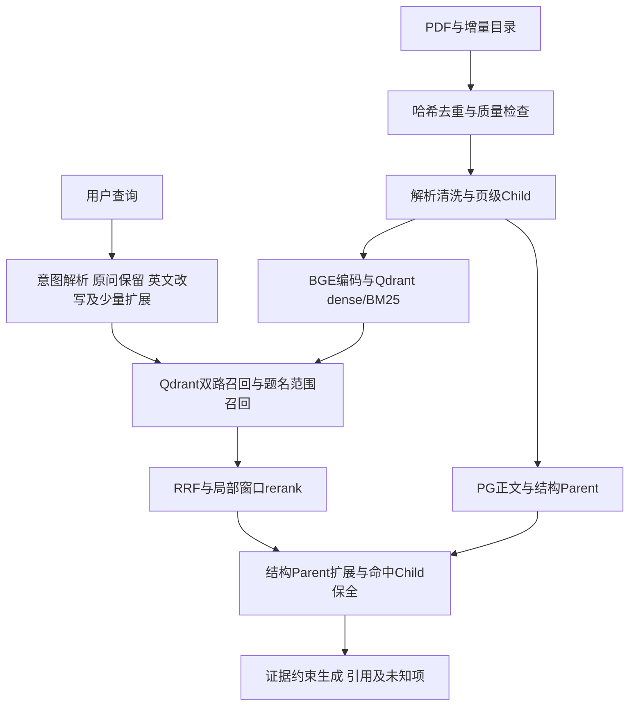

# ResearchClaw：个人科研论文库 RAG

截至2026-11-09，RAG实验阶段结束。当前版本可作为硕士生个人论文定位、阅读辅助和带证据问答工具；它不是自动证明创新性、自动完成系统综述或保证所有数学结论正确的系统。核心领域是时间序列压缩与误差控制，保留原深度学习与视觉资料。后续优先做长期交互与科研Agent集成，不继续为了排名无限调参。

## 1. 目标、现状与知识来源

当前正式库为204份PDF记录、3020个Parent、10955个Child；PDF数不等于独立学术作品数。同题不同版本没有静默合并。日常目标250–500份，配置硬上限2000份；2000不是已经压测通过的容量。本次交付不以达到250份为阻塞条件。

本文对应本地《八股文/RAG》的链路、embedding、向量库、chunking、问题排查、优化、长文档检索、Agentic RAG和RAGAS知识点。但教材中的“结构切分通常更好”等经验须经过本项目验证，不直接当作结果。实测口径与原始证据见[RAG性能指标](RAG性能指标.md)。

## 2. 整体架构与软件基础

在原ResearchClaw上改造，使用项目唯一`.venv`、Python 3.12和CPU本地模型；FastAPI后端与Vite前端在宿主机运行。Docker只运行约定的PostgreSQL与Qdrant基础设施，详见[环境约束](环境.md)。没有为RAG再建项目或新增常驻GROBID服务。

|位置|职责|
|---|---|
|PostgreSQL|正文、元数据、页、Parent、结构缓存以及应用状态的事务权威；不承担正式dense/BM25召回，不保存embedding副本|
|Qdrant|Child的dense语义向量与BM25 sparse索引，负责实际混合召回|
|文件系统|原始PDF、实验数据、备份和评测证据；不原地覆盖论文|

向量检索就是这里的语义检索，不把两者包装成独立的两路能力。关键词检索是另一条通道。PG读取标题目录以确定paper_id属于范围解析，不是用PG替代召回。



主要实现位于`src/researchclaw/knowledge/`下的`rag_pipeline.py`、`rag_retrieval.py`、`retrieval.py`、`qdrant_lexical.py`与`research_rag.py`。CLI入口为`scripts/research_rag.py`。

## 3. 离线：论文如何进入知识库

### 3.1 去重、解析与清洗

以PDF SHA256识别完全重复，记录解析器、清洗、分块及模型的fingerprint。不同字节的同题论文保留为不同记录；DOI/arXiv版本归并仍未完善。PyMuPDF提取本机可读文本与物理页码，清理重复页眉页脚、页码及异常文本，保留原PDF用于追溯。

当前不自动OCR。质量A表示通过现有文本提取检查，不表示公式、双栏、章节层次都正确。References停止规则可能漏掉后置附录；表格和公式也没有可靠的语义重建。对数学误差界，应回到PDF核对假设、符号、单位及定理全文，不能把清洗等级当作学术可信度评分。

### 3.2 分块：稳定Child加可信结构Parent

正式Child仍是`page-parent-word-child-v1`：页级Parent内约220词的重叠小块。它不是全库语义分块，也不是按完整章节切Child。保留小块是为了定位局部事实，Parent用于补上下文。

论文结构通过`paper-section-evidence-v1`发挥作用：启发式识别标题及页内章节范围，只有Child完整且唯一地落在可信章节内，才用章节Parent；不确定时退回页Parent。上下文聚焦约500词，并检查最终上下文是否保留真正命中的Child；若遗漏则补回。这样避免“检索命中，但生成看到的上下文把答案剪掉”。

为什么没有直接换成纯章节/语义Child？已有小样本直接证据命中从页级基线6/8下降到结构候选3/8。PDF标题识别、坐标对齐和跨栏顺序存在误差，语义完整的直觉不等于可靠的检索边界。该对照只支持“不推广当时的候选”，不能证明结构切分普遍无效。采用保守结构Parent，是在利用论文结构的同时保留稳定证据锚点。

### 3.3 Embedding与BM25

使用`BAAI/bge-small-en-v1.5`，384维归一化向量，固定revision `5c38ec7c405ec4b44b94cc5a9bb96e735b38267a`。查询与文档使用同一模型空间。英文论文为主、CPU预算有限，因此选择轻量英文模型；没有实验依据宣称BGE-m3等更大模型一定更差。

BM25适合方法名、缩写、数值术语等精确词匹配；dense补充同义表达。两者都在Qdrant检索。BM25的IDF依赖全库统计，增加论文后需要刷新旧点的sparse权重，因此“真正增量”不等于所有步骤都只触碰新增记录。

token审计发现150/10955个Child超过512 tokens，最长1693，p95约388。这部分存在embedding截断风险，尚未全面修复；不是所有失败都能归因为截断。

### 3.4 真正增量与发布

相同内容、策略及模型复用解析/结构缓存与向量；同revision无变化时不解析、不编码、不写dense/sparse。新revision可将旧向量复制至独立集合，新增论文单独编码，核对后发布。复制旧向量不是重新embedding，但仍有I/O成本。

12份增量输入中2份哈希重复，实际新增10份；原194份备份保留，10337个旧向量复用且最大数值差0。新增耗时101.156秒；no-op为6.485秒。删除、替换、历史正文回滚尚未完成同等级验收，不能把移走上传目录中的PDF当作删除正式库。

## 4. 在线：从问题到带来源答案

### 4.1 意图理解、改写和扩展

LLM结构化提取意图，生成英文检索表达及最多2个替代表达，用于同义/子问题扩展；保留原问，避免扩展把关键限定丢掉。可输出学术Boolean检索式，便于用户到Google Scholar等渠道补论文。有歧义应澄清或说明解释范围。此能力不等于已完成长期画像驱动的自主下载闭环。

### 4.2 双路召回与RRF

dense覆盖语义近似，BM25覆盖精确术语；RRF按排名融合，使用`1/(60+rank)`式贡献，避免直接相加尺度不一致的原始分数。跨改写合并后再做一次精排，比每个改写各自精排后再次精排更少放大漂移。

默认问答策略为`anchored`。原问明确给出有辨识度的完整题名或冒号前题名时，增加paper_id范围内的Qdrant召回，保留范围BM25证据，同时保留全局候选。未命名论文时退回一般coverage策略。这样修复“问指定论文的硬件，却回答另一篇硬件”的问题；它不是所有模糊简称都能可靠解析的实体链接器。

### 4.3 Rerank和上下文装配

精排使用`cross-encoder/ms-marco-MiniLM-L6-v2`，固定revision `233902d25c440f23af6f7d6e94d2946bac0bee0a`。coverage采用75%检索排名、25%cross-encoder排名融合，避免精排完全推翻召回；这是实测选择的参数，不是理论最优。

局部窗口使用192 tokens、重叠64，取最大相关分，帮助识别混合主题片段中的局部证据，但增加CPU开销，也可能偏爱偶然匹配。指定论文的范围通道与一般通道分别限制单篇Parent数，合并后没有全局“每篇最多2块”保证，实际可能达4块；总上下文5条。

随后做结构Parent扩展、去冗余和Child保全。过去发现6个生成样本在Parent聚焦后丢失命中Child，这属于上下文构造错误，已修复；不能只检查召回列表就断定生成证据完整。此次采用的anchored改变问答策略，没有重做PDF/向量，也没有更换论文搜索CLI默认排序。

### 4.4 生成、引用与科研边界

要求依据上下文回答，以`[S1]`等标注来源并给物理PDF页码，区分原文事实、综合推理与未知。证据不足时降级或拒答。创新点判断仅相对现有论文库，不把“未检索到”写成“全球首次”。Idea支持/反对和baseline建议可以辅助阅读，但实验执行仍须用户确认。

## 5. 评测与故障排查如何落地

遵循本地RAG排查资料中的分层方法：先看源PDF/提取文本，再看Child与向量，再看召回、重排、实际上下文，最后看生成和评分。保留dense、BM25、RRF、rerank及查询/上下文策略对照，而不是只展示最终一行分数。

冻结检索60题（48开发+12 held-out）、生成46题（34开发+12 held-out）；两侧有共享题目，共65个不同问题。覆盖事实、比较、条件、排除、版本和结构定位；生成另含5题不可答。held-out在开发选型后运行，不用于反复调参。12题held-out运行真实RAGAS 0.4.3，96/96评分完成。

标签以源论文预先编写的银标为主，不是公共基准或全人工金标。评分器与出题/生成使用同模型体系，有相关偏差；开发和held-out也非论文完全隔离，存在一对近似问法。已修复引用ID中`[S1]`与`S1`格式差异造成的评分解析错误，原始响应和修正账本均保留。

关键结果：held-out的full检索MRR@5为0.9583、ParentHit@10为0.875；anchored相对dense的RAGAS相关性0.5724→0.7358、上下文召回0.5417→0.7083。后者不等于“70.83%的论文知识全覆盖”。完整数字、分母及负结果见指标文档。

## 6. 做得好、做得不够与最终目标

做得较好的是实际增量复用、双路互补、指定论文约束、命中证据保全及可追溯评测。它们直接服务“新论文快速进入个人库—找到相关原文—得到有引用的阅读答案”，而非仅提高模型口头流畅度。

主要短板是跨篇综合不完整：anchored跨篇参考事实覆盖开发约0.54、held-out约0.45。高faithfulness只能说明已说出的内容较受证据支持，不能证明应说的都说了。多篇证据竞争有限上下文、重排偏向局部相关、原始结构不完整及银标差异都可能造成遗漏。当前不能把它用作无需人工核查的综述、定理条件总表或最终创新性裁决。

附录、公式、表格和同题版本管理仍有缺口；部分长块截断、CPU局部精排和LLM耗时也存在。一次中文指定论文CLI问答总耗时39.3秒，不能用旧的纯检索约2秒冒充端到端体验。个人非实时阅读可接受等待，不代表满足生产延迟目标。

这些短板会影响使用范围，但不阻止个人科研工具目标：用户可按篇/按条件追问、查看引用页及原PDF、手工核查跨篇差异，再自行作研究判断。系统承担证据导航和初步综合，不承担最终学术责任。这里是降低目标风险的明确边界，不是用定位掩盖失败指标。后续只在真实使用暴露问题时做针对性修复。

## 7. 如何运行

在ResearchClaw根目录的CMD中：

```bat
docker compose --env-file infra/.env -f infra/compose.yaml up -d
.venv\Scripts\activate
python -X utf8 -B scripts/research_rag.py ask "你的时间序列压缩科研问题"
python -X utf8 -B scripts/research_rag.py ingest --source "D:\新论文目录" --corpus-version "ts-next-batch"
python -X utf8 -B scripts/research_rag.py noop
```

使用既有环境配置，不把密钥写入报告。问答应能返回可定位的来源及证据不足提示；重复无变更构建应显示零解析/编码/向量写入。不要把示例目录当作已经创建或存在的论文路径。下一步工作统一见[v20261109](v20261109.md)。
